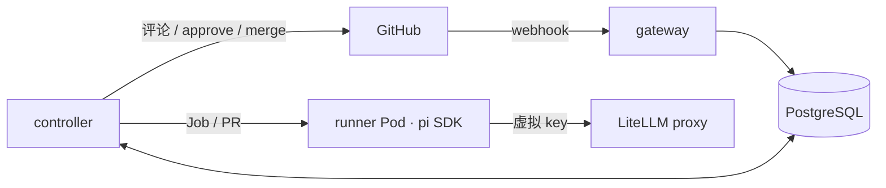

# ai-pr-review-cloud

装在 GitHub 上、跑在 Kubernetes 上的 AI PR 评审服务。PR 打开或更新时自动触发，每个 PR 在独立的 Pod 里由 agent 探索代码并给出结构化结论，结果以 Check Run 和 PR Review 呈现。AI 像人类审批人一样投票：没问题时提交 approve，可以计入"需要 N 个 approval"；有问题时只留评论、不阻塞合并。可按仓库开启自动合并和预览环境验证。

> 状态：M1、M2、M3、M4、M5、M6 完成。装上 GitHub App 后，PR 打开或更新会在 Kind 里起一个 runner Pod 评审，结果以 Check Run 和 PR Review（投票）出现在 PR 上；后续里程碑见 [roadmap](docs/roadmap.md)。

## 参赛材料

本项目参加赛道 B「云原生 Agent 实战」。各项材料的位置：

| 材料 | 位置 |
| --- | --- |
| 场景与价值分析 | [架构 §1 场景与价值](docs/architecture.md#1-场景与价值) |
| 系统架构设计 | [架构 §2 总体架构](docs/architecture.md#2-总体架构)、[§2.1 关键技术选型](docs/architecture.md#21-关键技术选型)、[§2.2 负载、状态、扩缩容与故障恢复](docs/architecture.md#22-负载状态扩缩容与故障恢复) |
| Agent 执行流程 | [架构 §4.2 执行流程](docs/architecture.md#42-执行流程)、[§4.4 评审结论](docs/architecture.md#44-评审结论模型决定形状对齐-github-review)、[§3 Run 状态机](docs/architecture.md#3-run-状态机) |
| 异常处理 | [架构 §2.2](docs/architecture.md#22-负载状态扩缩容与故障恢复)、[§4.3 崩溃恢复](docs/architecture.md#43-崩溃恢复) |
| Demo 与部署 | 下文"本地运行"、[三分钟演示](docs/demo.md)、[预览验证](docs/preview.md) |
| 成本与性能分析 | [成本与延迟测算报告](docs/cost-report.md) |
| 可观测性 | [架构 §7](docs/architecture.md#7-可观测性与成本)、[Grafana 看板截图](docs/cost-report.md#集群内实测) |
| 开发进度与验收记录 | [roadmap](docs/roadmap.md) |

## 架构



| 组件 | 目录 | 职责 |
| --- | --- | --- |
| gateway | [go/cmd/gateway](go/cmd/gateway) | 校验 webhook 签名，记录评审触发 |
| controller | [go/cmd/controller](go/cmd/controller) | 驱动评审状态机，创建 runner Job，执行所有 GitHub 写操作 |
| fetch | [go/cmd/fetch](go/cmd/fetch) | runner Pod 的 init 容器，持有只读 token 拉取代码后退出 |
| runner | [runner](runner) | 基于 pi SDK 的评审 agent，只产出结论，不持有 GitHub 凭据 |

完整设计见 [docs/architecture.md](docs/architecture.md)，进度见 [docs/roadmap.md](docs/roadmap.md)。

## 本地运行

前置：Go、Node.js ≥ 22.19、Docker、Kind、Helm、kubectl。

```bash
make test
```

```bash
make kind-up
```

```bash
make deploy
```

`make deploy` 会构建 4 个镜像、加载进 Kind，并用 Helm 安装到 `ai-pr-review-cloud` 命名空间（附带一个仅供开发用的 PostgreSQL，以及持有模型 key 的 LiteLLM proxy；首次部署要从 ghcr.io 拉取约 1.2 GB 的 LiteLLM 镜像）。模型 key 只交给 LiteLLM，每个 runner 拿到的是带预算上限的一次性虚拟 key，并且只能连到 DNS、LiteLLM 和 controller（[架构 §5](docs/architecture.md#5-安全边界)）。不设置下面的环境变量也能部署，只是 run 会停在排队状态。

### 接入 GitHub

1. 新建一个 smee.io 通道（打开 https://smee.io/new），记下地址。
2. 在 GitHub 的 Settings → Developer settings → GitHub Apps 注册一个 App：
   - Webhook URL 填 smee 通道地址，Webhook secret 自己生成一个随机串；
   - Repository 权限：Pull requests 读写、Checks 读写、Contents 读写、Metadata 只读（Contents 必须可写，否则 bot 的 APPROVE 不计入分支保护要求的审批数）；
   - 订阅事件：Pull request、Issue comment、Pull request review。
3. 生成私钥（.pem，放在仓库外），把 App 安装到要评审的仓库。
4. 设置环境变量后部署，再启动转发：

```bash
export GITHUB_APP_ID=<App ID> GITHUB_APP_PRIVATE_KEY_FILE=<.pem 路径> GITHUB_WEBHOOK_SECRET=<webhook secret> LLM_API_KEY=<DeepSeek API key>
```

```bash
make deploy
```

```bash
make webhook-forward SMEE_URL=<smee 通道地址>
```

之后在仓库里开 PR，几分钟内会出现 "AI Review" Check Run 和 bot 的评审。结论为 approve 时 bot 提交 APPROVE，可以计入分支保护要求的审批数；发现问题时只提交 COMMENT，不阻塞合并。查看进度：

```bash
kubectl -n ai-pr-review-cloud logs deploy/ai-pr-review-cloud-controller -f
```

### 预览验证

本仓库的 `.ai-pr-review.yaml` 已启用独立示例应用的预览。评审本仓库前，需要按 [预览验证指南](docs/preview.md) 开启服务端 `preview.enabled`，配置 API 地址白名单及可信镜像仓库映射。仓库要求预览而服务端未开启时，评审会明确失败，不会静默跳过验证。

M5 已用本仓库的错误探针 PR 验收：agent 读取 Kubernetes 事件和日志，确认探针返回 404，再给出 `request_changes`。验收记录见 [roadmap](docs/roadmap.md#m5-预览环境验证)。

### 三分钟演示

[`demo/demo.sh`](demo/demo.sh) 在本机部署上现场跑一次完整闭环：开 PR、独立 Pod 评审、中途删 Pod 后恢复、预览环境里用 kubectl 取证、投票并给出修复建议。[`demo/console.mjs`](demo/console.mjs) 把同一过程画成网页。步骤、时间线和彩排记录见 [演示指南](docs/demo.md)。

### 成本看板

`make deploy` 同时装上仅供开发用的 Prometheus 和 Grafana，Grafana 首页就是吞吐、各阶段耗时和每次评审成本的看板（[看板 JSON](deploy/helm/ai-pr-review-cloud/dashboards/review-cost.json)，指标见 [架构 §7.1](docs/architecture.md#71-指标)）。转发端口后打开 http://localhost:3000 ，匿名即可查看：

```bash
kubectl -n ai-pr-review-cloud port-forward svc/ai-pr-review-cloud-grafana 3000:3000
```

20 个 PR 的成本与延迟测算见 [docs/cost-report.md](docs/cost-report.md)。

runner 也可以脱离集群单独运行（本地模式）：评审一个 PR，把结论打印到 stdout。默认使用 DeepSeek 的 `deepseek-flash`，其他模型和参数见 [架构 §4.5](docs/architecture.md#45-模型接入)。

```bash
export LLM_API_KEY=<DeepSeek API key>
```

```bash
docker run --rm -e LLM_API_KEY -e GITHUB_TOKEN local/ai-pr-review-cloud-runner:dev --pr https://github.com/owner/repo/pull/1
```

不用 Docker 时在 `runner/` 下执行 `node src/main.ts --pr <url>`。常用参数：`--format json` 输出 [schema v3](contract/review-result.schema.json) JSON，`--language Chinese` 指定评审语言，`--budget 0.05` 在花费达到 80% 时要求模型尽快提交，`--stats <文件>` 写出 token、金额和各阶段耗时。`GITHUB_TOKEN` 可选，私有仓库需要。

## 目录结构

```
go/                         gateway、controller、fetch（Go）
runner/                     评审 agent（TypeScript，pi SDK）
contract/                   评审结论的 JSON schema 与 Go / TS 共用样例
deploy/helm/                Helm chart（含 Grafana 看板 JSON）
bench/                      成本测算：PR 列表、驱动脚本、原始结果与汇总脚本
hack/                       本地环境脚本
docs/                       架构设计、roadmap 与赛题
```
