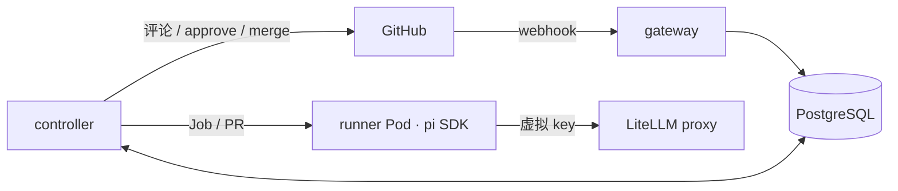

# ai-pr-review-cloud

装在 GitHub 上、跑在 Kubernetes 上的 AI PR 评审服务。PR 打开或更新时自动触发，每个 PR 在独立的 Pod 里由 agent 探索代码并给出结构化结论，结果以 Check Run 和 PR Review 呈现；可按仓库开启自动合并和预览环境验证。

> 状态：骨架阶段。服务能构建、部署、通过健康检查，评审流程按 [roadmap](docs/roadmap.md) 逐步实现。

## 架构



| 组件 | 目录 | 职责 |
| --- | --- | --- |
| gateway | [go/cmd/gateway](go/cmd/gateway) | 校验 webhook 签名，记录评审触发 |
| controller | [go/cmd/controller](go/cmd/controller) | 驱动评审状态机，创建 runner Job，执行所有 GitHub 写操作 |
| fetch | [go/cmd/fetch](go/cmd/fetch) | runner Pod 的 init 容器，持有只读 token 拉取代码后退出 |
| runner | [runner](runner) | 基于 pi SDK 的评审 agent，只产出结论，不持有 GitHub 凭据 |

完整设计见 [docs/architecture.md](docs/architecture.md)，进度见 [docs/roadmap.md](docs/roadmap.md)。

## 本地运行

前置：Go、Node.js ≥ 22.19、Docker、Kind、Helm、kubectl。

```bash
make test
```

```bash
make kind-up
```

```bash
make deploy
```

`make deploy` 会构建 4 个镜像、加载进 Kind，并用 Helm 安装到 `ai-pr-review-cloud` 命名空间（附带一个仅供开发用的 PostgreSQL）。

runner 也可以脱离集群单独运行：

```bash
docker run --rm local/ai-pr-review-cloud-runner:dev --pr https://github.com/owner/repo/pull/1
```

## 目录结构

```
go/                         gateway、controller、fetch（Go）
runner/                     评审 agent（TypeScript，pi SDK）
deploy/helm/                Helm chart
hack/                       本地环境脚本
docs/                       架构设计、roadmap 与赛题
```
