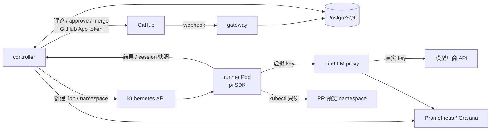
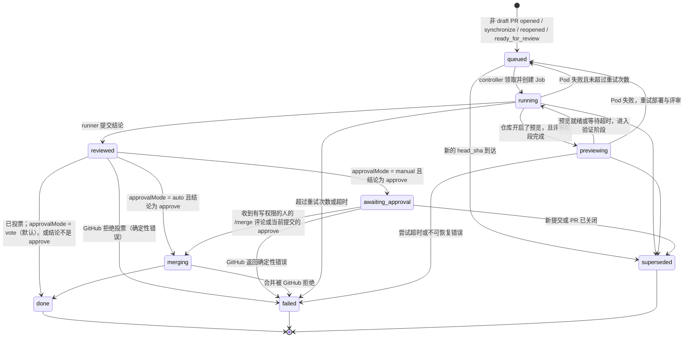

# ai-pr-review-cloud 架构设计

> 赛道 B「云原生 Agent 实战」参赛作品 · 进度与验收见 [roadmap](roadmap.md)，成本数据见 [cost-report](cost-report.md) · 前身 [ai-pr-review v1](https://github.com/RooobinYe/ai-pr-review)

v1 是本地 / CI 里运行的 Go CLI：克隆 PR，用自研 agent 循环先探索代码、再输出结构化结论。本项目从零实现一个装在 GitHub 上、跑在 Kubernetes 上的团队评审服务：PR 事件自动触发，每个 PR 一个隔离 Pod，可选部署预览环境让 agent 用 kubectl 验证，模型拿不到真实密钥，等待时不占算力，崩溃后自动恢复，按 PR 统计成本并设预算。沿用 v1 验证过的两阶段评审、证据优先的提示词、严重级别和 `--fail-on` 门禁（§6.4），agent 循环、provider、工具和 TUI 由 pi SDK 取代或不再需要。非目标：合并安全加固（`auto` 模式按原样提供）、多集群多租户、Web UI。

## 1. 场景与价值

目标用户是评审人手紧、要求"N 个 approval"的小团队和开源维护者，服务跑在 Kubernetes 上、很多问题要部署后才暴露的团队，以及不愿把代码和密钥交给第三方的团队。现有做法各有缺口：人工评审要排队，也不会为每个 PR 部署一遍；CI 静态检查只发现写成规则的问题，不理解意图；SaaS AI 评审机器人的结论停在评论，不计入必需审批（GitHub 文档明确 Copilot 的 review 不计入），代码要交给第三方，也不部署运行；v1 CLI 要人手动运行，崩溃从头再来，没有团队维度的成本与预算。

方案：AI 以 GitHub App bot 身份当审批人之一。结论为 approve 时提交 APPROVE review，计入"N 个 approval"；发现问题只提交 COMMENT，不阻塞合并（§6.3）。按仓库开启预览后，controller 为 PR 部署独立 namespace，agent 读 Pod 状态、事件和日志，把运行时证据和代码结论合在一起。这是 agent 拿到集群权限的唯一场景。用 agent 而不是把 diff 一次交给模型，是因为评审要多步取证：看到改动去读调用方、查历史、确认边界，开启预览时还要查日志，每一步看什么取决于上一步。

| 改进 | 证据 |
| --- | --- |
| 不止看 diff：只读工具 `read`、`grep`、`find`、`ls`、`git` | 平均每次评审 14.6 轮、26 次工具调用（[成本报告](cost-report.md#瓶颈分析)） |
| 发现运行时问题 | M5：探针路径写错的 PR，agent 查到探针返回 404 并 request_changes |
| 判断可信、成本可控 | 20 个 PR 各跑 3 次，19 个结论一致；P50 $0.029、端到端 P50 106 秒（[成本报告](cost-report.md#稳定性与结论质量)） |
| 中断后接着跑 | M3：评审中途删 Pod，从快照恢复，PR 上没有重复评论（§4.3） |

## 2. 总体架构



| 组件 | 职责 | 不做什么 |
| --- | --- | --- |
| `gateway`（Go） | 校验 webhook 签名，按 delivery ID 去重，记录评审触发或人工合并确认 | 不调 GitHub，不建 Job |
| `controller`（Go） | 驱动状态机：排队、建 Job 与预览、接收结果、执行全部 GitHub 写操作、超时与重试 | 不调用模型 |
| `fetch`（Go） | runner Pod 的 init 容器，用只读 token 拉代码和 PR 元信息 | 不给主容器留凭据 |
| `runner`（TypeScript，pi SDK） | 每个 run 一个 Job：探索代码、可选 kubectl 验证、经 `submit_review` 提交结论 | 不持有 GitHub 凭据 |
| LiteLLM、PostgreSQL | 持有真实模型 key、签发带预算的虚拟 key；保存全部状态 | — |

三条原则：副作用只在 controller，runner 只产出数据，可以随意重试；状态都在 PostgreSQL，任何进程可随时重启；等人或等事件表现为数据库状态，不是挂着的进程。交付为四个镜像（gateway、controller、fetch、runner）和一个 Helm chart（`deploy/helm/ai-pr-review-cloud`），`make kind-up && make deploy` 在本机复现；runner 镜像加 `--pr <url>` 即可单独当 CLI 用。

### 2.1 关键技术选型

| 决策 | 选择（对比方案） | 理由 |
| --- | --- | --- |
| 服务拆分 | gateway、controller、runner（单体） | 信任级别不同：gateway 面向公网且要快速返回，controller 集中副作用便于幂等，runner 跑受 PR 影响的模型，必须隔离，权限按最小原则分别给 |
| 执行单元 | 每次尝试一个 Job Pod（常驻 worker 池） | PR 不可信：一次性 Pod 有独立文件系统、专用凭据、NetworkPolicy 和资源上限，结束即销毁，空闲为零；冷启动 6 到 37 秒，相对 100 秒以上的评审可以接受 |
| 状态与调度 | PostgreSQL 状态机 + `FOR UPDATE SKIP LOCKED`（消息队列、Temporal） | 等待可能持续数天，一行数据比挂着的消息或工作流简单；唯一和 CHECK 约束直接表达"一个提交评审一次"等规则；少一个有状态组件 |
| GitHub 幂等 | 写前记账、先在 GitHub 上找已有结果（§3） | GitHub API 没有幂等键；controller 任何时刻崩溃重跑都不会重复评论或投票 |
| Agent 运行时 | pi SDK，精确锁定（自研循环、LangGraph） | session 可序列化为 JSONL 再载入，是崩溃恢复的基础；自带只读工具、重试和测试用 faux 模型 |
| 结论输出 | 带 schema 的 `submit_review` 工具（输出 JSON 再解析） | 参数受 schema 约束，锚点当场校验并把错误交还模型，消除格式失败 |
| 模型凭据 | LiteLLM 虚拟 key（注入真实 key、自写代理） | 被注入时最多花掉本 run 预算；吊销、预算、记账现成可用 |
| 模型 | DeepSeek `deepseek-flash`，thinking high | 约 $0.03 一次，93% 以上输入命中缓存，100 次测算都成功提交；降低思考强度会漏问题 |
| 语言 | 控制面 Go，runner TypeScript | pi 是 TypeScript；Go 镜像约 13 MB，直接调 Kubernetes REST，不引入 client-go |
| 集成与部署 | GitHub App；Helm chart，`make deploy` 一键拉起 | App 有 bot 身份和按仓库的短期 token；Actions 要每个仓库配置，无法统一调度和统计 |

### 2.2 负载、状态、扩缩容与故障恢复

**负载与扩缩容。** PR 事件是突发的，单次评审端到端 P50 106 秒、P95 224 秒，95% 以上在等模型 API，runner 只申请 250m CPU、512Mi 内存，所以瓶颈是模型 API 的并发、限流和预算，不是算力。runner 按需建 Job，并发上限 `runs.maxRunning`（默认 4，约每小时 135 次评审）直接按模型账户限额设置，不用 HPA；节点不够时 Pod Pending，可配合节点自动扩容，下一步可按 `review_queue_depth` 接 KEDA。gateway 无状态，2 副本；controller 不在内存保存状态，领取任务和迁移已在多副本间串行化，之后的步骤靠先查再写保证幂等，但未在多副本并发下实测，开启预览时必须单副本；生产环境 PostgreSQL 接外部托管库。

**状态与故障。** Pod 里没有不能重建的东西：评审进度在 `review_run.state`，完成过的 GitHub 写操作在 `github_action`，agent 上下文是 `run_session` 里每轮一份的快照，已花的钱在 `run_usage`（重试签发的 key 只给剩余预算），凭据是每次尝试一个、归 Job 所有的 Secret。失败都写进 Check Run，附原因和尝试次数，不会无限重试，推送新提交即重新评审。

| 故障 | 处理 |
| --- | --- |
| 工具调用出错、评论锚点不在 diff 上 | 错误作为工具结果交还模型，由它修正（§4.2） |
| 模型结束时没提交 | 追加提示最多 2 次，仍不提交则确定性失败 |
| 模型 API 失败；Pod 被删、驱逐、OOM | pi 重试 3 次；仍失败或 Pod 丢失时放回队列，新 Pod 从快照继续，最多 3 次尝试（§4.3） |
| 尝试超时、超出预算 | Job 时限到期即失败；预算耗尽以 `budget_exceeded` 失败，不重试（§7.3） |
| controller 重启、GitHub API 失败、webhook 丢失 | 状态在数据库，步骤幂等；限流和 5xx 下一轮重试，404、422 等直接失败；每 5 分钟重投失败的 webhook |

## 3. Run 状态机



一次 run 对应 `(repo, pr_number, head_sha)`。表结构以 [`migrations/`](../go/internal/store/migrations/) 为准：`review_run`（状态机载体，`UNIQUE (repo, pr_number, head_sha)`，`state`、`verdict` 用 CHECK 限定，产出结论后的状态要求 `verdict` 非空）、`webhook_delivery`（去重）、`github_action`（每个 GitHub 写操作一行）、`merge_signal`（人工确认）、`run_session`（快照，只保留最新一轮）、`run_usage`（每轮用量，重复上报覆盖）。状态取值在 [`run/state.go`](../go/internal/run/state.go) 里还有一份，改一处必须改另一处。GitHub 写操作先查 `github_action`，写成功回填 `external_id` 再推进状态；写成功但回填前崩溃时，Check Run 按 `external_id`、投票按正文末尾的 `<!-- ai-pr-review run=<id> -->` 在 GitHub 上找回，不写第二次。

## 4. runner 设计（pi SDK）

### 4.1 Pod 结构

```
Pod (Job: review-<run-id>-<attempt>)
├── initContainer: fetch    GITHUB_TOKEN（只读、1 小时、仅本仓库）、PROXY_TOKEN
│                           经 controller 的 CONNECT 代理克隆 head 往前 20 个提交和 base，写 /workspace/pr.json
├── container: runner       RUN_TOKEN（回调 controller）、LLM_API_KEY（本 run 的虚拟 key）
│                           根文件系统只读；不挂 ServiceAccount token；拿不到 fetch 的凭据
└── NetworkPolicy           出站只允许 DNS、LiteLLM、controller（预览阶段加 apiserver）；入站全部拒绝
```

NetworkPolicy 作用于整个 Pod，所以 fetch 也经 controller 访问 GitHub：代理只放行 `runs.fetchEgressHosts`，要求本 run 的 `PROXY_TOKEN` 且 run 仍在 `running`，TLS 端到端，controller 看不到 token。退出码 3 表示重试也没用（head 已变、GitHub 401/404/422、结果被拒、预算耗尽等），其余失败都重试。再次评审时 fetch 取回 bot 之前的逐行评论及其是否已解决，提示词要求不重复已解决的问题。

### 4.2 执行流程

1. 读 `pr.json`，构造提示词（`runner/src/prompts.ts`）。只用 runner 自己的提示词和资源，被评审仓库的 `AGENTS.md`、`.pi/` 扩展和技能都不加载；PR 标题、描述、diff 用 `*_untrusted` 标签包起来并转义伪造的闭合标签。
2. **探索**：只读工具 `read`、`grep`、`find`、`ls` 和只允许只读子命令的 `git`，不给 `bash`。
3. **预览验证**（可选）：controller 部署好预览后，runner 收到带 namespace 和部署状态的第二阶段提示，此时才启用只读 `kubectl`（Pod、事件、Deployment、ReplicaSet、日志）和 `submit_review`。系统提示词写明两个阶段各自可用的工具，只有第二阶段的提示要求提交，不靠"工具不存在"的报错教模型。
4. **提交**：`submit_review` 检查每条评论的 `path:line` 落在 diff 的新增行或上下文行上，不合法就把错误交还模型。模型结束时没提交则提醒，最多 2 次；最后一次是模型服务报错时直接以 `model API error` 失败。集群模式把结果 POST 给 controller（`RUN_TOKEN` 鉴权，5xx 退避重试，重复 POST 幂等）；本地模式（`--pr <url>`）自己拉取 PR，结果打印到 stdout。

### 4.3 崩溃恢复

runner 每轮结束时把 pi session 序列化成 JSONL，后台依次上传本轮用量和快照，失败只记日志。新 Pod 有快照就载入并追加"已恢复，从上次完成的步骤继续"的提示；崩在预览验证阶段的，重新取得预览访问后直接回到该阶段。快照里已有被接受的 `submit_review` 时直接上报它，不再调用模型。被打断的那一轮重跑，探索工具只读，重跑安全。Job 的 `backoffLimit: 0`，重试由 controller 决定：可重试且未到 `MAX_ATTEMPTS`（默认 3）就放回 `queued`，下一次尝试带新 Secret 和新 token。确定性失败、单次尝试超时、超过尝试上限直接 `failed`。每种故障都有测试：`go/internal/controller/recovery_test.go`、`runner/src/review.test.ts`。

### 4.4 评审结论：模型决定，形状对齐 GitHub Review

结论由模型决定并直接写正文，但必须以结构化数据交给 controller 去投票：runner 没有 GitHub 凭据，状态机靠 `verdict` 推进，逐行评论要 `path`、`line`，`failOn` 门禁要 `severity`。结构只保留这些字段，形状与一次 GitHub PR Review 对应：

| 字段 | 含义 | 去向 |
| --- | --- | --- |
| `verdict` | `approve` / `request_changes` | approve 投 APPROVE，request_changes 投 COMMENT（§6.3）；决定是否进入合并 |
| `body` | 简短的 Markdown 正文：改了什么、结论理由，以及未核实的疑点、没看的部分和至多 3 条次要建议 | review 正文、Check Run 摘要 |
| `comments[]` | `path`、`line`（新文件行号）、`severity`（critical/high/medium/low）、`body` | 逐行评论；`severity` 供 `failOn` |

`ReviewResult` 另加 `schema_version: 4`、`pr`（controller 据此拒绝不属于当前 run 的结果）、`model`、`generated_at`；最多 15 条评论，字段全必填，不允许多余字段。TypeScript 定义在 [`schema.ts`](../runner/src/schema.ts)，Go 在 [`review.go`](../go/internal/review/review.go)，[`contract/`](../contract/) 下生成的 JSON schema 和样例由两侧测试共同校验。逐行评论只给对照代码或运行时证据核实过、合并前值得处理的 critical、high、medium 问题，通常 0 到 5 条；未核实的疑点写进正文。存在核实过的 critical 或 high 问题、或没能审到最可能出问题的部分时 request_changes，其余 approve。探索不设固定配额，读到足以证实或排除每个疑点为止。v3 的逐行 `confidence` 已去掉：没有代码按它过滤，读者也难以据此判断。

### 4.5 模型接入

`LLM_API_KEY`、`LLM_PROVIDER`（默认 `deepseek`，非内置名按 OpenAI 兼容接口注册）、`LLM_MODEL`（`deepseek-flash`）、`LLM_BASE_URL`、`LLM_THINKING`（`high`）选择模型，不读写 `~/.pi`。花费按 pi 模型目录计价。集群模式只把 `baseUrl` 指向 LiteLLM；LiteLLM 要放行 `reasoning_effort`（pi 用它表达 thinking 级别），并按 `llm.pricing` 记账，价格须与 pi 目录一致。

## 5. 安全边界

PR 内容全部视为不可信输入。runner 主容器只有两样凭据：本 run 的虚拟 key（有预算上限、run 结束即吊销）和只能为本 run 提交结果的 `RUN_TOKEN`。真实模型 key 只在 LiteLLM；GitHub App 私钥和所有写操作只在 controller；只读 installation token 只在 fetch，init 容器退出后不可见；集群访问只在预览阶段，限 PR 自己 namespace 的只读资源；外网不可达。虚拟 key 在创建 Job 后签发：`max_budget` 取 run 预算减已上报花费，余额不足直接 `budget_exceeded`，有效期为 Job 时限加 5 分钟。run 离开 `running` 时吊销，吊销失败只记日志，靠到期兜底。被注入的模型最多浪费本 run 预算、给出错误结论；`vote` 模式下错误的 approve 只是一票，`auto` 模式下可能导致合并，这是明确接受的风险。

## 6. controller 关键逻辑

### 6.1 并发与调度

每 5 秒一轮 reconcile（有结果时立即触发），每一步都幂等：取代过时的 run、按 `maxRunning` 领取 `queued`、为 `running` 创建 Check Run、Job 和 Secret 并按 Job 状态重试或失败、为 `reviewed` 投票并推进、为 `superseded` 删除 Job 并把 Check Run 置为 cancelled。runner 有 requests 和 limits；controller 只有本 namespace 的 Role，直接调 Kubernetes REST，不引入 client-go。按仓库限制并发尚未实现。

### 6.2 预览环境

仓库在 `.ai-pr-review.yaml` 声明 Helm chart。runner 探索完把 chart 文件打包交给 controller；controller 离线 `helm template`，强制使用操作者映射的镜像仓库和 `:<head_sha>` tag，校验全部资源（只支持 Deployment、ClusterIP Service、ConfigMap）后部署到 `pr-<owner>-<repo>-<n>`，不执行 PR 的程序、插件或依赖下载。namespace 有 ResourceQuota、Restricted Pod Security 和默认拒绝的网络策略；就绪或超时后才把只读 ServiceAccount 的短期 token 交给 runner，超时保留现场供模型取证。PR 关闭或超过 24 小时的孤儿 namespace 由 controller 清理。预览 ClusterRole 由 `preview.enabled` 显式开启，此时 controller 必须单副本。操作步骤见 [预览验证](preview.md)。

### 6.3 投票与合并

| 结论（`failOn` 校验后） | review 事件 | `vote`（默认） | `auto` | `manual` |
| --- | --- | --- | --- | --- |
| `approve` | APPROVE | 投票后结束 | 投票后合并 | 等 `/merge` 或人工 approve |
| `request_changes` | COMMENT | 投票后结束 | 不合并 | 不合并 |

- 发现问题用 COMMENT 不用 REQUEST_CHANGES，后者会一直阻塞合并，AI 误判时卡住 PR。新提交的 run 开始时先撤销 bot 对旧提交仍有效的 APPROVE；投票前再查一次 head，已变则改投 COMMENT，不给没看过的代码计票。
- 每个 run 只投一票（正文隐藏标记，§3）；GitHub 拒绝逐行评论时折叠进正文重投。Check Run：approve 为 success，request_changes 为 neutral，失败为 failure。
- 是否合并只在 `decideMerge` 一个函数里决定（结论为 approve，且模式为 `auto`，或 `manual` 且已核实人工确认）。合并用 squash 并携带评审过的 `head_sha`，合并前再读一次 PR；确定性拒绝进入 `failed`，限流和 5xx 下一轮重试。`manual` 的确认只接受新建的、恰好为 `/merge` 的评论或针对当前 head 的 APPROVED review，确认人须有 write 以上权限，时间不早于本次评审完成；等待期间不留 runner Pod 和虚拟 key。

### 6.4 GitHub App 与仓库配置

App 订阅 `pull_request`、`issue_comment`、`pull_request_review`，权限为 Pull requests、Checks、Contents 的 write 和 Metadata read。**Contents 必须是 write**：分支保护只计算有写权限账号的审批，M1 实测只有 read 时 bot 的 APPROVE 不计入。fetch 的 token 每个 run 单独签发，只读、只能访问本仓库。gateway 只为非 draft PR 记录评审，转为正式 PR 时由 `ready_for_review` 触发；GitHub 不重试失败的 webhook，controller 每 5 分钟重投最近失败的投递。仓库根目录的 `.ai-pr-review.yaml` 设置 `approvalMode`（`vote` 默认、`auto`、`manual`）、`failOn`（默认 `high`）、`budgetUSD`、`language` 和 `preview`。controller 从 PR 目标分支的 base SHA 读取并随 run 保存，所以 PR 改配置不会改变自己的合并模式；非法配置使 run 失败并写进 Check Run。`failOn` 是 v1 `--fail-on` 的服务端版本：approve 但有达到阈值的评论时改为只投 COMMENT。

## 7. 可观测性与成本

### 7.1 指标

controller 的 `/metrics` 在抓取时从数据库计算（重启不归零、多副本一致），实现在 [`metrics.go`](../go/internal/metrics/metrics.go)：run 数、队列深度、结论、重试、失败原因（timeout、fetch、no_review、budget、model_api 等）、各阶段耗时（queue、startup、fetch、review、publish、total）、每次成本、token（含缓存读写）、按模型和按仓库的花费。用量由 runner 每轮上报，提交结果前等上报完成，done run 的花费是完整的。Grafana 看板 [`review-cost.json`](../deploy/helm/ai-pr-review-cloud/dashboards/review-cost.json) 随 chart 部署。

### 7.2 成本测算方法

选 20 个真实 PR，按改动行数分为 <100、100–500、>500 三档，每个跑 3 次，记录 token、金额和耗时，给出每档 P50 / P95 和"每 100 个 PR 的月成本"，再对比软预算、降低思考强度等优化。结果见 [成本测算报告](cost-report.md)：P50 $0.029、P95 $0.068；上下文膨胀大部分被前缀缓存消化，瓶颈在输出 token 和探索轮数。

### 7.3 预算控制

硬上限是虚拟 key 的 `max_budget`，超出后 LiteLLM 拒绝请求，run 以 `budget_exceeded` 失败（§5）；崩溃前未上报的花费可能遗漏，所以不是严格的账单上限。软上限在 runner：花费达到预算 80% 且未提交时，用 pi 的 `steer` 插入 [`budgetReminder`](../runner/src/prompts.ts)，要求按已核实的内容提交。有预览时探索阶段的提醒只要求结束本轮，进入验证阶段若仍超过阈值再提醒一次提交。按轮检查，实际花费会超出阈值一到两轮。

## 8. 风险与待确认

- **快照体积。** 每轮上传完整 session，流量随轮数平方增长；M3 实测 9 轮约 250 KB，上限 32 MiB，必要时改为只传新增 entry。
- **pi SDK 变动快。** 精确锁定 `1.3.0`，升级单独提交并重跑 M0 验收；换用其他模型要重新验证工具调用的稳定性。
- **网络隔离有缺口。** 集群 DNS 会替 runner 递归解析，理论上能带出少量数据，可给 CoreDNS 配只解析集群内域名的视图；不实施 NetworkPolicy 的 CNI 上隔离不存在，kindnet 对新 Pod 有几秒 fail-open，此时只有 fetch 在运行。
- **外部约定。** 预览要求被评审仓库的 CI 推送 `:<head_sha>` 镜像；本地经 smee 转发时自动重投 webhook 无效，需在 App 设置里手动重投。
