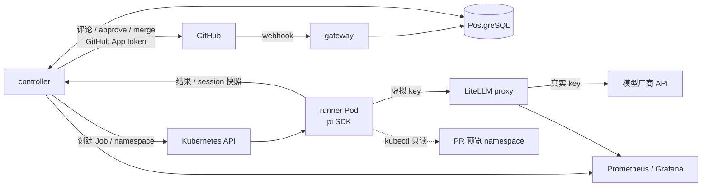
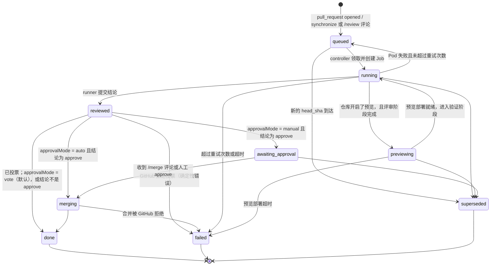

# ai-pr-review-cloud 架构设计

> 状态：M1 实现最小闭环（gateway 写库、controller 建 Job 并投票、fetch、runner 集群模式）；其余按 [roadmap](roadmap.md) 推进 · 目标：赛道 B「云原生 Agent 实战」参赛作品
> 前身：[ai-pr-review v1](https://github.com/RooobinYe/ai-pr-review)（Go CLI，见 §8.1） · 赛题见 [赛道B-AI-Application-赛题.md](赛道B-AI-Application-赛题.md)

## 0. 背景与目标

ai-pr-review v1 是一个本地 / CI 里运行的 CLI：输入 PR URL，克隆仓库，用自研的 agent 循环做两阶段评审（先用工具探索代码，再输出结构化 JSON），用 `--fail-on` 当质量门禁。

本项目在新仓库里从零实现，目标是把"一个人用的命令行工具"变成"装在 GitHub 上、跑在 k8s 上、给团队用的评审服务"：

| 目标 | 对应赛题考核点 |
| --- | --- |
| 安装为 GitHub App，PR 事件自动触发，无需人工运行 | 1 场景价值、4 工程完成度 |
| 每个 PR 一个隔离的 Pod 环境，并发评审 | 2 云原生架构（容器化、弹性、调度） |
| 可选：为 PR 部署预览环境，agent 用 kubectl 验证运行效果 | 1 场景价值、3 Agent 能力 |
| 模型拿不到真实密钥 | 2 云原生架构、3 链路质量 |
| 等待审批时不占算力；崩溃后自动恢复 | 2 分布式状态、3 容错与异常恢复 |
| 每个 PR 的 token 与金额统计、预算上限 | 5 成本与性能 |
| agent 循环基于 pi SDK，不再自研 agent 运行时 | 4 代码规范、可维护性 |

### 非目标（demo 阶段）

- **不做合并安全加固。** 默认的 `vote` 模式下 AI 只投一票，什么时候合并由仓库的 branch protection 和人决定。仓库可以选择 `auto` 模式，让 controller 在结论为 approve 时直接合并；这条路径不做额外加固。合并决策集中在 controller 的一个函数里（§6.3），生产环境在这里加确定性规则即可，agent 不用改。
- 不做多集群、多租户；只支持一个 GitHub App 实例。
- 不做 Web UI；交互全部发生在 GitHub（PR 评论、Check Run）和 Grafana。

## 1. 场景定位

**基础能力：PR 评审。** 沿用 v1 验证过的两阶段评审（先探索、再结论）。结论由模型自己决定：approve 还是 request_changes，加上一段评审正文和逐行评论，以 PR Review 和 Check Run 的形式呈现（§4.4）。

**AI 作为审批人之一。** 安装后，AI 以 GitHub App bot 的身份参与评审，和人类审批人一样投票：结论为 approve 时提交 APPROVE review；发现问题时只提交 COMMENT review，指出问题但不阻塞合并。仓库要求"N 个 approval 才能合并"时，AI 的 approve 可以算作其中一票（是否计入待实测，见 §10），其余由人来投。这是默认的 `vote` 模式，controller 不执行合并（§6.3）。

**差异化能力：预览环境验证（按仓库开启）。** 只看代码看不出的问题，在运行起来以后才暴露：配置错误、镜像起不来、探针失败、资源不足、依赖服务连不上。开启后，controller 为 PR 创建独立的 namespace 并部署，agent 用 kubectl 查看 Pod 状态、事件和日志，把运行时证据和代码评审结论合在一起，再给出结论。

这也是 agent 需要 kubectl 的唯一理由。纯代码评审阶段不给集群权限。

## 2. 总体架构



| 组件 | 语言 | 职责 | 不做什么 |
| --- | --- | --- | --- |
| `gateway` | Go | 校验 webhook 签名，按 delivery ID 去重，写入一条 run 记录，立即返回 202 | 不调 GitHub，不建 Job |
| `controller` | Go | 驱动 run 状态机：排队、建 Job、建预览环境、接收结果、执行所有 GitHub 写操作、超时与重试 | 不调用模型 |
| `fetch` | Go | runner Pod 的 init 容器：用只读 installation token 拉取代码和 PR 元信息，写入共享卷后退出 | 不在主容器里留下任何凭据 |
| `runner` | TypeScript（pi SDK） | 每个 run 一个 Job：探索代码、可选的 kubectl 验证、通过 `submit_review` 工具提交结构化结论 | 不持有 GitHub 凭据，不直接写 GitHub |
| LiteLLM proxy | 现成组件 | 持有真实模型 key；为每个 run 签发带预算上限的虚拟 key；记录花费 | — |
| PostgreSQL | 现成组件 | run 状态机、GitHub 副作用记录、session 快照、用量 | — |

设计原则：

- **所有副作用集中在 controller。** runner 只产出数据，不改变外部世界（预览环境除外，且只读）。这样 runner 可以随意重试，GitHub 上不会出现重复评论。
- **状态都在 PostgreSQL。** gateway、controller、runner 都可以随时重启。
- **等待不占 Pod。** 任何需要等人或等事件的环节，都表现为数据库里的一个状态，而不是一个挂着的进程。

## 3. Run 状态机

一次 run 对应 `(repo, pr_number, head_sha)`。同一个 PR 推送新提交，旧 run 被标记为 `superseded`，对应的 Job 被删除。



进入 `reviewed` 后，controller 先发布 PR Review（即投票，§6.3），再按 `approvalMode` 决定去向。默认的 `vote` 模式下 run 到 `done` 就结束，之后的合并与本系统无关。

### 3.1 数据表

表结构以 [`go/internal/store/migrations/0001_init.sql`](../go/internal/store/migrations/0001_init.sql) 为准，这里只说明每张表的作用和约束：

| 表 | 作用 | 关键约束 |
| --- | --- | --- |
| `review_run` | 一次评审，状态机的载体；记录 `installation_id`（controller 换 token 用）和失败原因 `error`（写到 Check Run） | `UNIQUE (repo, pr_number, head_sha)`；`state`、`verdict` 用 CHECK 限定取值；处于 `reviewed`、`awaiting_approval`、`merging`、`done` 时 `verdict` 必须非空；活跃 run 有部分索引供 controller 扫描 |
| `webhook_delivery` | 已记录的 webhook delivery ID，GitHub 重投时去重 | 主键 `delivery_id` |
| `github_action` | 每个 GitHub 写操作一行：`dismiss_stale_approvals`（撤销旧票）、`check_run_create`、`check_run_complete`、`review`（投票，§6.3）、`merge`（M4） | 主键 `(run_id, kind)`；`external_id` 非空表示已完成；取值在 `go/internal/store/store.go` 里也有一份 |
| `run_session` | runner 每轮结束上传的 pi session 快照，用于崩溃恢复 | 每个 run 只保留最新一份 |
| `run_usage` | 每轮的模型、token 和金额 | 主键 `(run_id, turn)`，重复上报覆盖而不是累加 |

状态取值在 [`go/internal/run/state.go`](../go/internal/run/state.go) 里也有一份，同时定义了上图的全部合法转换，改一处必须同步另一处。

controller 启动时执行嵌入的迁移（`schema_migration` 表记录已执行的版本，advisory lock 串行化多副本）。领取任务用 `SELECT ... FOR UPDATE SKIP LOCKED`，多副本 controller 也不会重复领取。GitHub 写操作前先查 `github_action`，`external_id` 非空就跳过；写成功后回填 `external_id`，再推进状态。写成功但回填前崩溃会重复这一次写操作，M3 处理。

## 4. runner 设计（pi SDK）

### 4.1 Pod 结构

```
Pod (Job: review-<run-id>-<attempt>)
├── initContainer: fetch（alpine + git）
│     env: GITHUB_TOKEN = 只读、1 小时有效、只能访问本仓库的 installation token
│                         （来自 Secret review-<run-id>-<attempt>-credentials，归 Job 所有，随 Job 删除）
│          REPO, PR_NUMBER, HEAD_SHA, WORKSPACE=/workspace
│     作用: 克隆 head（往前 20 个提交）到 /workspace/repo、拉取 base、写出 /workspace/pr.json（元信息 + diff）
│     token 经 git 的环境变量配置传入，不进 argv 和 .git/config；结束后随容器退出，主容器读不到
├── container: runner
│     env: RUN_ID, CONTROLLER_URL, RUN_TOKEN（回调 controller 用，同一个 Secret 的另一个 key，fetch 读不到）,
│          LLM_API_KEY（M1 为共享 Secret，M2 换成 LiteLLM 虚拟 key）
│     volume: /workspace、/tmp (emptyDir)；根文件系统只读
│     serviceAccount: 不挂载 token；预览阶段使用绑定到 PR namespace 的只读 SA
└── NetworkPolicy: 出站只允许 LiteLLM proxy、controller、kube-apiserver（预览阶段）
```

两个容器都以 UID 1000（runner 镜像的 `node` 用户）运行，git 才会信任 fetch 留下的工作区。blob 一次拉全，不用部分克隆：runner 没有凭据，之后也没有外网，无法按需补拉。fetch 发现 PR 的 head 已不是本 run 的 `head_sha` 时直接失败，新提交有自己的 run。

容器失败时，退出信息（`terminationMessagePolicy: FallbackToLogsOnError`，即日志末尾）由 controller 读出，写进 `review_run.error` 和 Check Run。

### 4.2 执行流程

沿用 v1 的两阶段思路，但第二阶段从"让模型输出一段 JSON 再解析"改为"调用一个带 schema 的工具"，彻底消除 JSON 解析失败的情况。

1. 读 `/workspace/pr.json`，构造系统提示词和用户提示词。提示词按 v1 的防幻觉规则重写，放在 `runner/src/prompts.ts`。
2. **探索阶段**：pi 内置的只读工具 `read`、`grep`、`find`、`ls`，加上自定义的 `git` 工具（只允许 `log`、`show`、`diff`、`blame` 等只读子命令，不经过 shell），`cwd` 为 `/workspace/repo`。评审阶段不给 `bash`：本地模式跑在开发者机器上，一个带注入的 PR 不应能执行任意命令。
3. **预览验证阶段**（可选）：controller 部署好预览环境后，runner 收到一条 follow-up 提示，附上 namespace 名称；此时才加入 `bash`，其中的 `kubectl` 只能访问这个 namespace。
4. **提交阶段**：模型调用 `submit_review`，参数是 §4.4 的 `verdict`、`body`、`comments`。工具先检查每条评论的 `path:line` 是否落在 diff 的新增行或上下文行上（GitHub 只接受这些位置），不合法就把错误返回给模型让它改；合法则记录结果并结束本轮 agent。若模型结束时没调用，追加提示要求提交，最多 2 次，之后判为失败。
5. 结束 session，进程以 0 退出。集群模式把结果 `POST {CONTROLLER_URL}/runs/{id}/result`，带 `Authorization: Bearer <RUN_TOKEN>`，controller 读本 run 的 Secret 比对，不符返回 401：网络错误和 5xx 退避重试，4xx 不重试；controller 对同一结果的重复 POST 返回成功，所以响应丢失后重试是安全的。

本地模式（`--pr <url>`）走同样的流程，只是第 1 步自己用 GitHub API 拉取 PR、部分克隆（`--filter=blob:none`，head 往前 20 个提交加 base 提交）到临时目录，最后把结果按 `--format markdown|json` 打印到 stdout，token 与金额打印到 stderr。

prompt 和资源完全由 runner 提供：不使用 pi 默认的资源发现，被评审仓库里的 `AGENTS.md`、`.pi/` 扩展和技能都不会加载。它们是 PR 作者可控的内容，加载扩展等于执行 PR 里的代码。PR 标题、描述和 diff 在提示词里用 `*_untrusted` 标签包起来，并转义其中伪造的闭合标签。

以下摘自 `runner/src/review.ts`，基于 pi SDK `1.3.0`（`runner/package.json` 精确锁定）：

```ts
const { session } = await createAgentSession({
  cwd,
  agentDir,                                          // 临时目录，不读 ~/.pi
  model,
  modelRuntime,
  thinkingLevel,
  resourceLoader: isolatedResources(systemPrompt(language)),
  sessionManager: SessionManager.inMemory(cwd),      // M3 换成可恢复的 session，见 4.3
  settingsManager: SettingsManager.inMemory({ retry: { enabled: true, maxRetries: 3 } }),
  tools: ["read", "grep", "find", "ls", "git", "submit_review"],
  customTools: [gitTool(cwd), submitReviewTool(commentableLines(pr.diff), onSubmit)],
});

// 集群模式（M1、M3）：每轮结束上报快照和用量
session.subscribe(async (e) => {
  if (e.type === "turn_end") {
    await controller.putSession(runId, await readSessionFile());   // 崩溃恢复快照
    await controller.putUsage(runId, usageOf(e));                  // usage.input / output / cost.total
  }
});

await session.prompt(userPrompt(pr));
for (let i = 0; !submitted && i < MAX_SUBMIT_REMINDERS; i++) await session.prompt(SUBMIT_REMINDER);
```

### 4.3 崩溃恢复

| 场景 | 处理 |
| --- | --- |
| runner Pod 被驱逐、OOM、节点故障 | Job 失败，controller 把 run 放回 `queued`、`attempt + 1`，新 Pod 启动后 `GET /runs/{id}/session`，有快照就 `SessionManager.open(file)` 继续，否则从头开始 |
| 中途崩在某次工具调用里 | 恢复后最后一轮会重跑。探索阶段工具都是只读的，重跑安全 |
| 模型 API 超时 / 限流 | pi 自带 `auto_retry`；仍失败则整个 Pod 失败，走上一行 |
| `submit_review` 已调用但进程在退出前崩溃 | controller 已收到结果并推进到 `reviewed`，Job 失败被忽略 |
| controller 重启 | 状态全在数据库，重新扫描即可；`github_action` 保证不重复评论 |
| 超过 `attempt` 上限或总时长 | 状态置为 `failed`，在 Check Run 上标记失败并给出原因 |

### 4.4 评审结论：模型决定，形状对齐 GitHub Review

结论由模型自己给出：它读完代码后决定 approve 还是 request_changes，并直接写出给人看的评审正文。runner 不再像 v1 那样让模型填一份 `must_fix` / `points_of_interest` 报告、再由程序拼成 Markdown。

但这个决定仍然要以结构化数据交出来，由 controller 代表 AI 去 GitHub 投票（§6.3），而不是让模型自己调用 GitHub：

- runner 没有 GitHub 凭据（§5），所有写操作集中在 controller，结论只能作为数据交给它；
- controller 要靠 `verdict` 推进状态机（`reviewed` → `merging` / `awaiting_approval` / `done`）；
- 逐行评论需要 `path` 和 `line`；`failOn` 门禁需要 `severity`。

所以结构只保留机器真正用到的字段，其余都是模型写的 Markdown。形状和一次 GitHub PR Review 一一对应。`request_changes` 表示模型认为"还不能合并"，是结论的取值，不是 GitHub 的 review 事件名：

| 字段 | 含义 | 去向 |
| --- | --- | --- |
| `verdict` | `approve` / `request_changes` | 投票：`approve` 提交 APPROVE review，`request_changes` 提交 COMMENT review（§6.3）；`auto` / `manual` 模式下还决定是否进入合并 |
| `body` | Markdown 正文：改了什么、结论理由、验证了什么、没看的部分、自检行 | review 正文、Check Run 摘要 |
| `comments[]` | `path`、`line`（新文件行号）、`severity`（critical/high/medium/low）、`confidence`（high/medium/low）、`body` | 逐行评论；`severity` 供 `failOn` 使用 |

runner 交给 controller 的 `ReviewResult` 在此之外加上 `schema_version: 3`、`pr`（`repo`、`number`、`head_sha`，controller 用来拒绝不属于当前 run 的结果）、`model`、`generated_at`。评论最多 15 条，所有字段必填，不允许多余字段。

两侧定义：TypeScript 在 [`runner/src/schema.ts`](../runner/src/schema.ts)（TypeBox，同时作为 `submit_review` 的参数 schema），Go 在 [`go/internal/review`](../go/internal/review/review.go)。[`contract/review-result.schema.json`](../contract/review-result.schema.json) 由 TypeBox 生成，`contract/examples/` 里的合法、非法样例由两侧测试共同校验；Go 测试还会核对字段、枚举、上限与生成的 schema 一致，并检查 `verdict` 取值与数据库 CHECK 约束一致。

提示词里的判定规则（`verdict_policy`）：存在中高置信度的 critical 或 high 问题时 request_changes；中低级别、风格建议和不确定的发现只作为评论，不阻塞合并；没能审到最可能出问题的部分时也应 request_changes 并说明原因。防幻觉规则沿用 v1：每条评论必须引用读到的代码，不确定的标 `[Uncertain]` 并给低置信度，critical/high 要做反向检验。

### 4.5 模型接入

runner 通过环境变量选择模型，`ModelRuntime` 不读写 `~/.pi`：

| 变量 | 默认 | 说明 |
| --- | --- | --- |
| `LLM_API_KEY` | — | 必填。集群模式下是 LiteLLM 虚拟 key（M2） |
| `LLM_PROVIDER` | `deepseek` | pi 内置 provider 保留其模型目录（价格、兼容参数）；其他名称按 OpenAI 兼容接口注册 |
| `LLM_MODEL` | `deepseek-flash` | |
| `LLM_BASE_URL` | — | 覆盖 provider 地址，集群模式指向 LiteLLM |
| `LLM_THINKING` | `high` | `off` 到 `max` |

花费按 pi 模型目录的单价计算，`usage` 含 `input`、`output`、`cacheRead`、`cacheWrite`、`cost.total`。DeepSeek 会返回缓存命中量：M0 验收的三个 PR 里，缓存读取的 token 是非缓存输入的 11 到 14 倍。

## 5. 安全边界

demo 不做合并加固，但"模型拿不到真实密钥"是本项目的目标之一，而且实现成本低。PR 内容（代码、描述、评论）全部视为不可信输入。

| 凭据 / 能力 | 谁持有 | runner 主容器能否拿到 |
| --- | --- | --- |
| 模型厂商真实 API key | LiteLLM proxy | 否。只有本次 run 的虚拟 key，带预算上限，run 结束即吊销 |
| GitHub App 私钥 | controller | 否 |
| GitHub 只读 installation token | fetch initContainer | 否。initContainer 退出后不可见 |
| 回调 token（`RUN_TOKEN`） | controller、本 run 的 runner 主容器 | 是，只能为本 run 提交结果；没有它无法伪造结论让 bot 投 APPROVE |
| GitHub 写操作（评论、approve、merge） | controller | 否。runner 只能提交结论 |
| 集群访问 | 预览阶段的只读 SA | 只限 PR 自己的 namespace：pods、pods/log、events、deployments 的 get/list/watch |
| 外网访问 | — | 否。NetworkPolicy 只放行 proxy、controller 和 apiserver |

被注入的模型最多能做到：浪费本次 run 的预算、给出错误结论。默认的 `vote` 模式下，错误的 approve 只是一票，仍要满足仓库其余的审批要求；`auto` 模式下错误结论可能导致合并，这是 §0 里明确接受的风险。

## 6. controller 关键逻辑

### 6.1 并发与调度

- 全局最大并发 `maxRunning`，单仓库最大并发 `maxRunningPerRepo`，超出的 run 留在 `queued`。
- runner 所在 namespace 配 `ResourceQuota` 和 `LimitRange`，防止一次大 PR 吃光节点。
- Job 设置 `activeDeadlineSeconds`、`ttlSecondsAfterFinished`；`backoffLimit: 0`，重试由 controller 统一决定（这样才能带上 session 快照恢复）。
- 冷启动优化：runner 镜像预装 pi 依赖和 git（M5 再加 kubectl）；fetch 阶段浅克隆（depth 1 + 按需拉 base）。实测后再决定要不要加 git mirror 缓存。
- 权限：controller 只有自己 namespace 内的 Role，可以管理 `jobs`、读取 `pods`、创建、读取和删除每个 run 的 `secrets`（fetch 的 token；M2 起还有虚拟 key、回调 token）。M5 的预览环境需要创建 namespace，届时再加一个只含 `namespaces` 的 ClusterRole。
- Kubernetes 访问：controller 只用到 Job、Secret、Pod 的少数几个调用，`go/internal/kube` 直接调 REST API（in-cluster token 每次请求重读），不引入 client-go，controller 镜像保持在十几 MB。M5 需要部署 Helm chart 时再评估。
- 每轮 reconcile（5 秒一次，收到结果时立即触发）：领取 `queued`；对 `running` 依次撤销旧票、创建 Check Run、确保 Job 和 token Secret 存在、按 Job 状态判定失败；对 `reviewed` 投票、完成 Check Run、推进到 `done`；对已失败但 Check Run 还没收尾的 run 补写失败结论。每一步都是幂等的，崩溃后重跑即可。

### 6.2 预览环境

- 仓库在 `.ai-pr-review.yaml` 里声明部署方式（Helm chart 路径或 kustomize 目录）。
- controller 创建 `pr-<owner>-<repo>-<n>` namespace，配 ResourceQuota，用 PR 的镜像 tag 部署，等待 Ready 或超时。
- PR 关闭或合并时删除 namespace；另有定时清理，删掉超过 24 小时的孤儿 namespace。
- 构建镜像依赖仓库自己的 CI。demo 里约定 PR 的 CI 推送 `:<head_sha>` 镜像，controller 等这个 tag 出现。

### 6.3 投票与合并

AI 的身份是 GitHub App bot（如 `ai-pr-review[bot]`）。每个 run 结束时，controller 调用 `POST /repos/{owner}/{repo}/pulls/{n}/reviews` 提交一条 PR Review，这就是 AI 的一票，和人在 PR 页面选择 Approve 后提交是同一个接口：

| 结论（`failOn` 校验后） | review 事件 | `vote`（默认） | `auto` | `manual` |
| --- | --- | --- | --- | --- |
| `approve` | APPROVE | 投票后结束 | 投票后合并 | 投票后等待 `/merge` 或人工 approve |
| `request_changes` | COMMENT | 投票后结束 | 不合并 | 不合并 |

- **发现问题时用 COMMENT，不用 REQUEST_CHANGES。** REQUEST_CHANGES 会一直阻塞合并，直到 bot 改投或有人 dismiss；AI 误判时会卡住 PR。COMMENT 把问题写清楚，是否合并留给人。
- **新提交到达时撤销旧票。** COMMENT 不会覆盖 bot 之前的 APPROVE，旧票会一直计数。所以同一个 PR 的新 `head_sha` 的 run 开始时，controller 先 dismiss bot 在该 PR 上针对其他提交、仍然有效的 APPROVE，再评审新提交；新的 approve 只针对评审过的 `head_sha`（review 的 `commit_id`）。仓库开了"Dismiss stale pull request approvals"时 GitHub 也会自动撤销，两者不冲突。
- **只在评审的提交仍是 head 时投 APPROVE。** 旧提交的 run 可能在新 run 撤销旧票之后才完成；此时投 APPROVE 会给没看过的代码计一票。所以投票前查一次 PR 的 head，不一致就改投 COMMENT。M3 的 `superseded` 会更早终止这类 run。
- **逐行评论被拒时折叠进正文。** `submit_review` 已保证锚点落在 diff 内，GitHub 仍返回 422 时，controller 把评论按严重程度列进 review 正文重新提交，不丢内容。
- **Check Run 的结论**：approve 为 `success`，request_changes 为 `neutral`（结论由投票表达；若仓库把 "AI Review" 设为必需检查，`failure` 会阻塞合并），run 失败为 `failure` 并附原因。
- **AI 的票计入"需要 N 个 approval"的前提**是 GitHub 把 App 的 APPROVE 算作有效审批（待实测，§10）。branch protection 要求 Code Owners 审批时，这一项只能由人满足，App 不能成为 code owner。

是否合并只在一个函数里决定：

```go
// decideMerge 是唯一决定是否合并的地方。默认的 vote 模式从不合并，
// 合并交给仓库的 branch protection 和人。auto 模式只看 AI 结论；
// 生产环境在这里加确定性规则（作者白名单、路径、改动行数、CI 状态）。
func decideMerge(run ReviewRun, cfg RepoConfig) bool {
	return cfg.ApprovalMode == ApprovalAuto && run.Verdict == VerdictApprove
}
```

合并调用 GitHub 的 merge API，仍受仓库 branch protection 约束。

### 6.4 GitHub App

| 项 | 取值 |
| --- | --- |
| 订阅事件 | `pull_request`（opened、synchronize、reopened、closed）、`issue_comment`（`/review`、`/merge`）、`pull_request_review` |
| 权限 | Pull requests: write（投票、撤销旧票）、Contents: read（fetch 克隆代码；`auto` / `manual` 合并需要 write，M4）、Checks: write、Metadata: read |
| 呈现方式 | 一个 "AI Review" Check Run 显示进度和结果摘要；一条 PR Review，正文为结论的 `body`，逐行评论来自 `comments` 的 `path`、`line`；review 事件按 `verdict` 取 APPROVE 或 COMMENT（§6.3） |

gateway 已实现签名校验（`X-Hub-Signature-256`）和 `pull_request` 的 opened、synchronize、reopened 三种触发，按 delivery ID 去重后写入 `queued` 的 run；`closed`、`issue_comment`、`pull_request_review` 在 M3 到 M5 接入。

controller 用 App 私钥签 JWT（RS256，9 分钟有效），换取 installation token：自己的写操作用全权限 token，按 installation 缓存、过期前 5 分钟续期；fetch 的 token 每个 run 单独签发，限定到被评审的仓库和 `contents`、`pull_requests`、`metadata` 的只读权限。bot 的登录名（`<slug>[bot]`）启动时通过 `GET /app` 取得，用来识别要撤销的旧票。

本地开发时，GitHub App 的 webhook 指向一个 smee.io 通道，`make webhook-forward SMEE_URL=...` 把事件转发到 Kind 里的 gateway。

### 6.5 仓库配置 `.ai-pr-review.yaml`

```yaml
approvalMode: vote        # vote（默认，只投票）| auto（approve 后合并）| manual（approve 后等 /merge）
failOn: high              # 有该级别及以上的评论时不投 APPROVE
budgetUSD: 0.50           # 单个 run 的预算上限
language: zh              # 评论语言
preview:
  enabled: true
  helm:
    chart: deploy/chart
    valuesFile: deploy/values-preview.yaml
  readyTimeout: 5m
```

没有配置文件或省略某项时取默认值，`approvalMode` 默认为 `vote`。

`failOn` 在 controller 里对 `result.comments` 做确定性校验：模型给了 approve 但存在 `severity` 达到阈值的评论时，结论改写为 request_changes，即只发 COMMENT、不投 APPROVE。这是把原 CLI 的 `--fail-on` 门禁搬到服务端，作为模型判断之外的一道确定性兜底。

## 7. 可观测性与成本

### 7.1 指标

| 指标 | 来源 |
| --- | --- |
| `review_runs_total{state}`、`review_run_duration_seconds{phase}`（排队、拉代码、探索、预览、提交） | controller |
| `review_queue_depth`、`review_running` | controller |
| `review_tokens_total{model,direction}`、`review_cost_usd_total{repo}` | controller（来自 runner 上报的 `usage`） |
| 每个虚拟 key 的花费 | LiteLLM（作为核对口径） |
| Job 失败原因、重试次数 | controller |

所有日志带 `run_id`、`repo`、`pr`、`head_sha`。Grafana 一张看板：吞吐、各阶段耗时分布、每 PR 成本分布、失败原因。

### 7.2 成本测算方法

1. 选 20 个真实 PR，按改动行数分三档（<100、100–500、>500）。
2. 每个 PR 跑 3 次，记录 token、金额、各阶段耗时。
3. 给出每档的 P50 / P95 成本和端到端延迟，算出"每 100 个 PR 的月成本"。
4. 找出主要瓶颈，预计在探索阶段的上下文膨胀，对比优化效果：限制探索轮数、开启 prompt cache、小模型做探索加大模型做结论。

### 7.3 预算控制

- 虚拟 key 自带 `max_budget`，超出后 proxy 直接拒绝，run 以 `failed(budget_exceeded)` 结束，并在 Check Run 上说明。
- runner 侧在 `turn_end` 累计 `usage.cost.total`，达到预算 80% 时追加一条提示，要求尽快提交结论。

## 8. 与 v1 的关系、仓库结构与交付形式

### 8.1 与 v1 的关系

本项目是 [ai-pr-review v1](https://github.com/RooobinYe/ai-pr-review) 的重新设计。v1 是一个本地 / CI 里运行的 Go CLI，自研了 agent 循环、工具、TUI 和权限系统。本仓库从零开始，不复制 v1 的代码，只沿用它验证过的设计：

| 沿用自 v1 | 在本项目中的形态 |
| --- | --- |
| 两阶段评审：先用工具探索仓库，再给出结构化结论 | runner 的探索阶段 + `submit_review` 工具（§4.2）；模型直接给出 verdict |
| 评审提示词与防幻觉规则（XML 结构、证据要求、置信度说明） | runner 的系统提示词，按新流程重写 |
| 输出 schema v2：`must_fix` / `points_of_interest`、严重级别、置信度、`schema_version` | 改为 schema v3（§4.4）：保留严重级别和置信度，`must_fix` 的判断交给模型的 `verdict`，报告式字段换成模型直接写的正文和逐行评论；Go 与 TS 两侧用契约测试对齐 |
| `--fail-on` 质量门禁 | controller 里对评论 `severity` 的确定性校验，超标时不投 APPROVE（§6.5） |
| 按文件类型分类改动（code / test / config / doc） | 提示词里的文件分类与评论分组 |

v1 中由 pi SDK 取代的部分（agent 循环、模型 provider、上下文压缩、内置工具），以及服务端不需要的部分（TUI、交互式权限确认、本地凭据管理），不再保留。v1 仓库继续作为独立的 CLI 存在。

### 8.2 仓库结构

```
ai-pr-review-cloud/
├── go/                              # Go module
│   ├── cmd/gateway/                 # webhook 入口（装配）
│   ├── cmd/controller/              # 状态机驱动（装配、迁移）
│   ├── cmd/fetch/                   # runner 的 init 容器（装配）
│   ├── internal/gateway/            # webhook 处理：验签、解析触发、写入 run
│   ├── internal/controller/         # reconcile 循环、Job 模板、投票与 Check Run 呈现、结果回调
│   ├── internal/fetch/              # 拉取 PR 元信息与 diff、克隆、写 pr.json
│   ├── internal/githubapp/          # webhook 签名与触发、App JWT 与 installation token、REST 客户端
│   ├── internal/kube/               # 最小 Kubernetes REST 客户端（Job、Secret、Pod）
│   ├── internal/store/              # PostgreSQL 访问与迁移
│   ├── internal/review/             # 评审结论 schema v3（与 runner 对齐）
│   ├── internal/run/                # run 状态与合法转换
│   ├── internal/store/migrations/   # PostgreSQL 表结构
│   └── Dockerfile                   # 用 --build-arg CMD=<组件> 构建三个镜像
├── runner/                          # TypeScript，pi SDK 1.3.0
│   ├── src/main.ts                  # 集群模式（RUN_ID）与本地模式（--pr）入口
│   ├── src/controller.ts            # 集群模式回调 controller
│   ├── src/pr.ts                    # PR 上下文及 pr.json 校验
│   ├── src/review.ts                # pi session、工具、提交提醒
│   ├── src/prompts.ts               # 系统提示词与用户提示词
│   ├── src/schema.ts                # 评审结论 schema v3（TypeBox）
│   ├── src/tools.ts                 # git、submit_review 工具
│   ├── src/github.ts                # 本地模式拉取 PR 与克隆
│   └── Dockerfile
├── contract/                        # 生成的 JSON schema、两侧共用的样例、pr.json 与 diff 契约
├── deploy/helm/ai-pr-review-cloud/  # Helm chart
├── hack/kind-up.sh                  # 创建本地 Kind 集群
├── hack/webhook-forward.sh          # smee.io → gateway 的 webhook 转发
├── Makefile                         # test、lint、images、kind-up、deploy
├── .github/workflows/ci.yaml        # Go、runner、chart、镜像构建
└── docs/
```

### 8.3 交付形式

面向 k8s 交付，分三层：

| 层 | 产物 | 用途 |
| --- | --- | --- |
| 容器镜像 | `gateway`、`controller`（Go 静态编译，distroless nonroot，各约 13 MB）、`fetch`（Go + alpine git，约 28 MB）、`runner`（Node 24 slim + git，约 460 MB） | 每个组件一个镜像，独立发布和扩缩容；命名为 `<registry>/ai-pr-review-cloud-<组件>:<tag>` |
| Helm chart | `deploy/helm/ai-pr-review-cloud` | 集群部署的唯一入口 |
| 本地复现 | `make kind-up && make deploy` | 在本机 Kind 集群里一键拉起整套系统 |

chart 目前包含：

- gateway（2 副本）和 controller（1 副本）的 Deployment 与 Service，都以非 root、只读根文件系统、丢弃全部 capability 运行；
- controller 的 ServiceAccount 和最小 Role（§6.1）；
- GitHub App 的 webhook secret、App ID 和私钥：可以引用已有 Secret（`github.existingSecret`），开发时也可由 chart 根据 `github.*` 生成；
- runner 使用的模型 key（`llm.existingSecret` 或 `llm.apiKey`，M2 换成 LiteLLM 虚拟 key）和模型参数，以及 `runs.*`（并发上限、单个 Job 时限、评审语言、默认预算）；
- 仅供开发用的单副本 PostgreSQL（`postgres.dev.enabled`，数据不持久化）；关闭后通过 `database.existingSecret` 接入外部数据库。

LiteLLM proxy 和 runner 的 NetworkPolicy 在 M2 加入，预览环境所需的 ClusterRole 在 M5 加入。

`make deploy` 的密钥只从环境变量读取：`GITHUB_WEBHOOK_SECRET`（缺省时用一个固定的开发值）、`GITHUB_APP_ID`、`GITHUB_APP_PRIVATE_KEY_FILE`、`LLM_API_KEY`。没有 App ID 时 controller 照常启动，但 run 停在 `queued`，所以不配置 GitHub App 也能把整套服务拉起来。

runner 镜像也可以脱离集群单独使用：`docker run` 加 `--pr <url>` 即为本地模式，等价于 v1 的 CLI 用法。

## 9. 里程碑

里程碑、每个阶段的任务清单与验收标准见 [roadmap.md](roadmap.md)。

## 10. 风险与待确认

- **run 进行中的失败处理。** M1 没有重试：Job 失败、超时，或 GitHub 返回确定性错误（401、403（限流除外）、404、410、422）时，run 直接置为 `failed`；投票被拒也一样（`reviewed` → `failed`）。失败一律写到 Check Run，Check Run 还没创建时补建一个已失败的；连 Check Run 都写不进去时只记日志，不再重试。重试与 session 恢复在 M3。
- **pi SDK 版本变动快。** 包名已从 `@mariozechner` 迁到 `@earendil-works`，初始化方式也从 `AuthStorage` 换成了 `ModelRuntime`，两周内从 1.1 发到 1.4。目前精确锁定 `1.3.0`，升级单独提交并跑一遍 M0 的验收。
- **pi 的 `usage` 字段。** 已确认含 `cacheRead`、`cacheWrite`，DeepSeek 会填充 `cacheRead`（§4.5）；金额按 pi 目录单价计算，M2 时与 LiteLLM 的花费交叉校验。
- **自定义模型接入。** DeepSeek 是 pi 内置 provider，指向 LiteLLM 只需覆盖 `baseUrl`；`deepseek-flash` 在 M0 的三个 PR 上都一次调用成功 `submit_review`。换用其他模型时要重新验证工具调用的稳定性。
- **LiteLLM 虚拟 key 与预算。** 依赖其 key 管理和花费统计（需要它自己的数据库）；落地前用选定版本验证 `max_budget` 是否按预期拒绝请求。
- **工具链版本较新。** runner 用 TypeScript 7.0、Go 镜像用 `golang:1.27`，本地验证通过，GitHub Actions 上还没跑过。
- **评论锚点与后续推送。** `submit_review` 保证评论落在 diff 内，controller 发布时以结果里的 `head_sha` 为 `commit_id`，PR 之后的推送不会让锚点错位；GitHub 仍拒绝时把评论折叠进正文（§6.3）。
- **GitHub App 的 approve 是否计入"需要 N 个 approval"。** 这是 `vote` 模式的前提。GitHub 文档没有明确说明 App 的 review 是否计入，只明确说 Copilot 的 review 不计入；社区经验是专用 GitHub App 的 approve 会计入。M1 在要求 2 个审批的 demo 仓库上实测：bot 加一个人能否合并。若不计入，退路是用一个机器用户账号投票，代价是要管理它的凭据。
- **撤销旧票的权限。** dismiss review 需要 App 有 Pull requests: write；若 branch protection 限制了谁能 dismiss review，要把 App 加入允许名单。M1 一并验证。
- **预览环境的镜像约定。** 需要 demo 仓库的 CI 配合推送 `:<head_sha>` 镜像。
