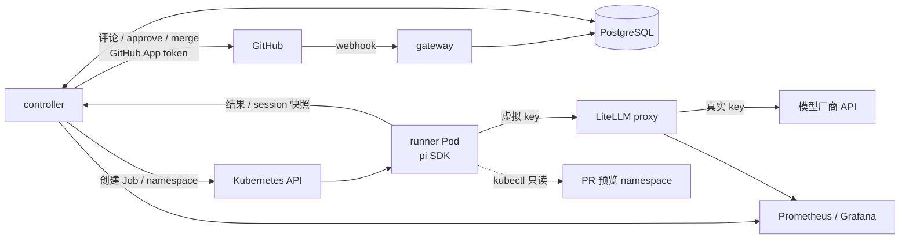
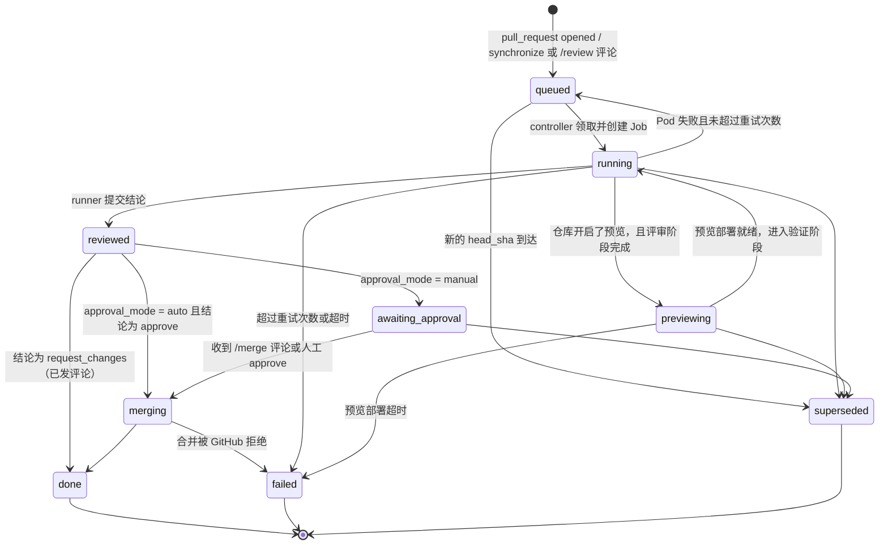

# ai-pr-review-cloud 架构设计

> 状态：骨架已就绪，评审流程按 [roadmap](roadmap.md) 推进 · 目标：赛道 B「云原生 Agent 实战」参赛作品
> 前身：[ai-pr-review v1](https://github.com/RooobinYe/ai-pr-review)（Go CLI，见 §8.1） · 赛题见 [赛道B-AI-Application-赛题.md](赛道B-AI-Application-赛题.md)

## 0. 背景与目标

ai-pr-review v1 是一个本地 / CI 里运行的 CLI：输入 PR URL，克隆仓库，用自研的 agent 循环做两阶段评审（先用工具探索代码，再输出结构化 JSON），用 `--fail-on` 当质量门禁。

本项目在新仓库里从零实现，目标是把"一个人用的命令行工具"变成"装在 GitHub 上、跑在 k8s 上、给团队用的评审服务"：

| 目标 | 对应赛题考核点 |
| --- | --- |
| 安装为 GitHub App，PR 事件自动触发，无需人工运行 | 1 场景价值、4 工程完成度 |
| 每个 PR 一个隔离的 Pod 环境，并发评审 | 2 云原生架构（容器化、弹性、调度） |
| 可选：为 PR 部署预览环境，agent 用 kubectl 验证运行效果 | 1 场景价值、3 Agent 能力 |
| 模型拿不到真实密钥 | 2 云原生架构、3 链路质量 |
| 等待审批时不占算力；崩溃后自动恢复 | 2 分布式状态、3 容错与异常恢复 |
| 每个 PR 的 token 与金额统计、预算上限 | 5 成本与性能 |
| agent 循环基于 pi SDK，不再自研 agent 运行时 | 4 代码规范、可维护性 |

### 非目标（demo 阶段）

- **不做合并安全加固。** AI 结论为 `approve` 时，controller 直接 approve 并合并。合并决策集中在 controller 的一个函数里（§6.3），生产环境在这里加确定性规则即可，agent 不用改。
- 不做多集群、多租户；只支持一个 GitHub App 实例。
- 不做 Web UI；交互全部发生在 GitHub（PR 评论、Check Run）和 Grafana。

## 1. 场景定位

**基础能力：PR 评审。** 沿用 v1 验证过的两阶段评审和 schema v2 输出，结果以 PR Review 评论和 Check Run 的形式呈现。

**差异化能力：预览环境验证（按仓库开启）。** 只看代码看不出的问题，在运行起来以后才暴露：配置错误、镜像起不来、探针失败、资源不足、依赖服务连不上。开启后，controller 为 PR 创建独立的 namespace 并部署，agent 用 kubectl 查看 Pod 状态、事件和日志，把运行时证据和代码评审结论合在一起，再给出结论。

这也是 agent 需要 kubectl 的唯一理由。纯代码评审阶段不给集群权限。

## 2. 总体架构



| 组件 | 语言 | 职责 | 不做什么 |
| --- | --- | --- | --- |
| `gateway` | Go | 校验 webhook 签名，按 delivery ID 去重，写入一条 run 记录，立即返回 202 | 不调 GitHub，不建 Job |
| `controller` | Go | 驱动 run 状态机：排队、建 Job、建预览环境、接收结果、执行所有 GitHub 写操作、超时与重试 | 不调用模型 |
| `fetch` | Go | runner Pod 的 init 容器：用只读 installation token 拉取代码和 PR 元信息，写入共享卷后退出 | 不在主容器里留下任何凭据 |
| `runner` | TypeScript（pi SDK） | 每个 run 一个 Job：探索代码、可选的 kubectl 验证、通过 `submit_review` 工具提交结构化结论 | 不持有 GitHub 凭据，不直接写 GitHub |
| LiteLLM proxy | 现成组件 | 持有真实模型 key；为每个 run 签发带预算上限的虚拟 key；记录花费 | — |
| PostgreSQL | 现成组件 | run 状态机、GitHub 副作用记录、session 快照、用量 | — |

设计原则：

- **所有副作用集中在 controller。** runner 只产出数据，不改变外部世界（预览环境除外，且只读）。这样 runner 可以随意重试，GitHub 上不会出现重复评论。
- **状态都在 PostgreSQL。** gateway、controller、runner 都可以随时重启。
- **等待不占 Pod。** 任何需要等人或等事件的环节，都表现为数据库里的一个状态，而不是一个挂着的进程。

## 3. Run 状态机

一次 run 对应 `(repo, pr_number, head_sha)`。同一个 PR 推送新提交，旧 run 被标记为 `superseded`，对应的 Job 被删除。



### 3.1 数据表

表结构以 [`go/internal/store/migrations/0001_init.sql`](../go/internal/store/migrations/0001_init.sql) 为准，这里只说明每张表的作用和约束：

| 表 | 作用 | 关键约束 |
| --- | --- | --- |
| `review_run` | 一次评审，状态机的载体 | `UNIQUE (repo, pr_number, head_sha)`；`state`、`verdict` 用 CHECK 限定取值；处于 `reviewed`、`awaiting_approval`、`merging`、`done` 时 `verdict` 必须非空；活跃 run 有部分索引供 controller 扫描 |
| `github_action` | 每个 GitHub 写操作一行（`check_run_create`、`review_comment`、`approve`、`merge`） | 主键 `(run_id, kind)`；`external_id` 非空表示已完成 |
| `run_session` | runner 每轮结束上传的 pi session 快照，用于崩溃恢复 | 每个 run 只保留最新一份 |
| `run_usage` | 每轮的模型、token 和金额 | 主键 `(run_id, turn)`，重复上报覆盖而不是累加 |

状态取值在 [`go/internal/run/state.go`](../go/internal/run/state.go) 里也有一份，同时定义了上图的全部合法转换，改一处必须同步另一处。

controller 领取任务用 `SELECT ... FOR UPDATE SKIP LOCKED`，多副本 controller 也不会重复领取。GitHub 写操作前先查 `github_action`，`external_id` 非空就跳过；写成功后在同一个事务里回填 `external_id` 并推进状态。

## 4. runner 设计（pi SDK）

### 4.1 Pod 结构

```
Pod (Job: review-<run-id>)
├── initContainer: fetch
│     env: GITHUB_TOKEN = 只读、1 小时有效的 installation token
│          REPO, PR_NUMBER, HEAD_SHA, WORKSPACE=/workspace
│     作用: 浅克隆 head 到 /workspace/repo、拉取 base、写出 /workspace/pr.json（元信息 + diff）
│     结束后 token 随容器退出，主容器读不到
├── container: runner
│     env: RUN_ID, RUN_TOKEN（回调 controller 用）, LLM_API_KEY = LiteLLM 虚拟 key
│     volume: /workspace (emptyDir)
│     serviceAccount: 默认无权限；预览阶段使用绑定到 PR namespace 的只读 SA
└── NetworkPolicy: 出站只允许 LiteLLM proxy、controller、kube-apiserver（预览阶段）
```

### 4.2 执行流程

沿用 v1 的两阶段思路，但第二阶段从"让模型输出一段 JSON 再解析"改为"调用一个带 schema 的工具"，彻底消除 JSON 解析失败的情况。

1. 读 `/workspace/pr.json`，构造系统提示词和用户提示词。提示词按 v1 的防幻觉规则重写，放在 `runner/src/prompts.ts`。
2. **探索阶段**：内置工具 `read`、`grep`、`find`、`bash`，`cwd` 为 `/workspace/repo`。
3. **预览验证阶段**（可选）：controller 部署好预览环境后，runner 收到一条 follow-up 提示，附上 namespace 名称；此时 `bash` 里的 `kubectl` 只能访问这个 namespace。
4. **提交阶段**：模型调用 `submit_review`，参数即 schema v2 的 `ReviewOutput` 加 `verdict`，工具的 `execute` 把结果 POST 给 controller。若模型结束时没调用，追加一次提示要求提交，最多 2 次，之后判为失败。
5. 结束 session，进程以 0 退出。

本地模式（`--pr <url>`）走同样的流程，只是第 1 步自己拉取 PR，第 4 步把结果打印到 stdout。

以下示例基于 pi SDK `1.3.0`（`runner/package.json` 精确锁定），其中 `createAgentSession`、`defineTool`、`SessionManager`、`ModelRuntime` 均已确认可导入：

```ts
import { createAgentSession, defineTool, SessionManager } from "@earendil-works/pi-coding-agent";
import { ReviewOutputSchema } from "./schema.ts"; // TypeBox，与 Go 侧 schema v2 对齐

const submitReview = defineTool({
  name: "submit_review",
  label: "Submit review",
  description: "Submit the final structured review. Call exactly once when done.",
  parameters: ReviewOutputSchema, // schema v2 外加 verdict
  execute: async (_id, params) => {
    await controller.postResult(runId, params);
    submitted = true;
    return { content: [{ type: "text", text: "Review submitted." }], details: {} };
  },
});

const { session } = await createAgentSession({
  cwd: "/workspace/repo",
  model,
  modelRuntime,
  tools: ["read", "grep", "find", "bash", "submit_review"],
  customTools: [submitReview],
  sessionManager: await restoreOrCreateSession(runId), // 有快照用 SessionManager.open，否则 create，见 4.3
});

session.subscribe(async (e) => {
  if (e.type === "turn_end") {
    await controller.putSession(runId, await readSessionFile());   // 崩溃恢复快照
    await controller.putUsage(runId, usageOf(e));                  // usage.input / output / cost.total
  }
});

await session.prompt(userPrompt);
```

### 4.3 崩溃恢复

| 场景 | 处理 |
| --- | --- |
| runner Pod 被驱逐、OOM、节点故障 | Job 失败，controller 把 run 放回 `queued`、`attempt + 1`，新 Pod 启动后 `GET /runs/{id}/session`，有快照就 `SessionManager.open(file)` 继续，否则从头开始 |
| 中途崩在某次工具调用里 | 恢复后最后一轮会重跑。探索阶段工具都是只读的，重跑安全 |
| 模型 API 超时 / 限流 | pi 自带 `auto_retry`；仍失败则整个 Pod 失败，走上一行 |
| `submit_review` 已调用但进程在退出前崩溃 | controller 已收到结果并推进到 `reviewed`，Job 失败被忽略 |
| controller 重启 | 状态全在数据库，重新扫描即可；`github_action` 保证不重复评论 |
| 超过 `attempt` 上限或总时长 | 状态置为 `failed`，在 Check Run 上标记失败并给出原因 |

## 5. 安全边界

demo 不做合并加固，但"模型拿不到真实密钥"是本项目的目标之一，而且实现成本低。PR 内容（代码、描述、评论）全部视为不可信输入。

| 凭据 / 能力 | 谁持有 | runner 主容器能否拿到 |
| --- | --- | --- |
| 模型厂商真实 API key | LiteLLM proxy | 否。只有本次 run 的虚拟 key，带预算上限，run 结束即吊销 |
| GitHub App 私钥 | controller | 否 |
| GitHub 只读 installation token | fetch initContainer | 否。initContainer 退出后不可见 |
| GitHub 写操作（评论、approve、merge） | controller | 否。runner 只能提交结论 |
| 集群访问 | 预览阶段的只读 SA | 只限 PR 自己的 namespace：pods、pods/log、events、deployments 的 get/list/watch |
| 外网访问 | — | 否。NetworkPolicy 只放行 proxy、controller 和 apiserver |

被注入的模型最多能做到：浪费本次 run 的预算、给出错误结论。demo 里错误结论可能导致合并，这是 §0 里明确接受的风险。

## 6. controller 关键逻辑

### 6.1 并发与调度

- 全局最大并发 `maxRunning`，单仓库最大并发 `maxRunningPerRepo`，超出的 run 留在 `queued`。
- runner 所在 namespace 配 `ResourceQuota` 和 `LimitRange`，防止一次大 PR 吃光节点。
- Job 设置 `activeDeadlineSeconds`、`ttlSecondsAfterFinished`；`backoffLimit: 0`，重试由 controller 统一决定（这样才能带上 session 快照恢复）。
- 冷启动优化：runner 镜像预装 pi 依赖和 git（M5 再加 kubectl）；fetch 阶段浅克隆（depth 1 + 按需拉 base）。实测后再决定要不要加 git mirror 缓存。
- 权限：controller 只有自己 namespace 内的 Role，可以管理 `jobs`、读取 `pods`、创建和删除每个 run 的 `secrets`（虚拟 key、回调 token）。M5 的预览环境需要创建 namespace，届时再加一个只含 `namespaces` 的 ClusterRole。

### 6.2 预览环境

- 仓库在 `.ai-pr-review.yaml` 里声明部署方式（Helm chart 路径或 kustomize 目录）。
- controller 创建 `pr-<owner>-<repo>-<n>` namespace，配 ResourceQuota，用 PR 的镜像 tag 部署，等待 Ready 或超时。
- PR 关闭或合并时删除 namespace；另有定时清理，删掉超过 24 小时的孤儿 namespace。
- 构建镜像依赖仓库自己的 CI。demo 里约定 PR 的 CI 推送 `:<head_sha>` 镜像，controller 等这个 tag 出现。

### 6.3 合并决策

```go
// decideMerge 是唯一决定是否合并的地方。demo 阶段只看 AI 结论；
// 生产环境在这里加确定性规则（作者白名单、路径、改动行数、CI 状态）。
func decideMerge(run ReviewRun, cfg RepoConfig) bool {
	return cfg.ApprovalMode == ApprovalAuto && run.Verdict == VerdictApprove
}
```

合并调用 GitHub 的 merge API，仍受仓库 branch protection 约束。

### 6.4 GitHub App

| 项 | 取值 |
| --- | --- |
| 订阅事件 | `pull_request`（opened、synchronize、reopened、closed）、`issue_comment`（`/review`、`/merge`）、`pull_request_review` |
| 权限 | Pull requests: write、Contents: write（合并）、Checks: write、Metadata: read |
| 呈现方式 | 一个 "AI Review" Check Run 显示进度和结果摘要；一条 PR Review 带逐行评论（来自 `must_fix` / `points_of_interest` 每条的 `file`、`line`）；结论为 approve 时提交 APPROVE review |

gateway 目前已实现签名校验（`X-Hub-Signature-256`）和 `pull_request` 的 opened、synchronize、reopened 三种触发；`closed`、`issue_comment`、`pull_request_review` 在 M1 和 M4 接入。

### 6.5 仓库配置 `.ai-pr-review.yaml`

```yaml
approvalMode: auto        # auto | manual
failOn: high              # 有该级别及以上的 must_fix 时结论必须为 request_changes
budgetUSD: 0.50           # 单个 run 的预算上限
language: zh              # 评论语言
preview:
  enabled: true
  helm:
    chart: deploy/chart
    valuesFile: deploy/values-preview.yaml
  readyTimeout: 5m
```

`failOn` 在 controller 里对 `result.must_fix` 做确定性校验：模型给了 approve 但存在超标的 must_fix 时，结论改写为 request_changes。这是把原 CLI 的 `--fail-on` 门禁搬到服务端。

## 7. 可观测性与成本

### 7.1 指标

| 指标 | 来源 |
| --- | --- |
| `review_runs_total{state}`、`review_run_duration_seconds{phase}`（排队、拉代码、探索、预览、提交） | controller |
| `review_queue_depth`、`review_running` | controller |
| `review_tokens_total{model,direction}`、`review_cost_usd_total{repo}` | controller（来自 runner 上报的 `usage`） |
| 每个虚拟 key 的花费 | LiteLLM（作为核对口径） |
| Job 失败原因、重试次数 | controller |

所有日志带 `run_id`、`repo`、`pr`、`head_sha`。Grafana 一张看板：吞吐、各阶段耗时分布、每 PR 成本分布、失败原因。

### 7.2 成本测算方法

1. 选 20 个真实 PR，按改动行数分三档（<100、100–500、>500）。
2. 每个 PR 跑 3 次，记录 token、金额、各阶段耗时。
3. 给出每档的 P50 / P95 成本和端到端延迟，算出"每 100 个 PR 的月成本"。
4. 找出主要瓶颈，预计在探索阶段的上下文膨胀，对比优化效果：限制探索轮数、开启 prompt cache、小模型做探索加大模型做结论。

### 7.3 预算控制

- 虚拟 key 自带 `max_budget`，超出后 proxy 直接拒绝，run 以 `failed(budget_exceeded)` 结束，并在 Check Run 上说明。
- runner 侧在 `turn_end` 累计 `usage.cost.total`，达到预算 80% 时追加一条提示，要求尽快提交结论。

## 8. 与 v1 的关系、仓库结构与交付形式

### 8.1 与 v1 的关系

本项目是 [ai-pr-review v1](https://github.com/RooobinYe/ai-pr-review) 的重新设计。v1 是一个本地 / CI 里运行的 Go CLI，自研了 agent 循环、工具、TUI 和权限系统。本仓库从零开始，不复制 v1 的代码，只沿用它验证过的设计：

| 沿用自 v1 | 在本项目中的形态 |
| --- | --- |
| 两阶段评审：先用工具探索仓库，再给出结构化结论 | runner 的探索阶段 + `submit_review` 工具（§4.2） |
| 评审提示词与防幻觉规则（XML 结构、证据要求、置信度说明） | runner 的系统提示词，按新流程重写 |
| 输出 schema v2：`must_fix` / `points_of_interest`、严重级别、置信度、`schema_version` | `submit_review` 的参数 schema，Go 与 TS 两侧各定义一份并用契约测试对齐 |
| `--fail-on` 质量门禁 | controller 里对 `must_fix` 的确定性校验（§6.5） |
| 按文件类型分类改动（code / test / config / doc） | 提示词里的文件分类与评论分组 |

v1 中由 pi SDK 取代的部分（agent 循环、模型 provider、上下文压缩、内置工具），以及服务端不需要的部分（TUI、交互式权限确认、本地凭据管理），不再保留。v1 仓库继续作为独立的 CLI 存在。

### 8.2 仓库结构

```
ai-pr-review-cloud/
├── go/                              # Go module
│   ├── cmd/gateway/                 # webhook 入口（已实现签名校验与触发解析）
│   ├── cmd/controller/              # 状态机驱动（目前只有健康检查）
│   ├── cmd/fetch/                   # runner 的 init 容器（目前只校验参数）
│   ├── internal/githubapp/          # webhook 签名、事件到触发的转换
│   ├── internal/run/                # run 状态与合法转换
│   ├── internal/store/migrations/   # PostgreSQL 表结构
│   └── Dockerfile                   # 用 --build-arg CMD=<组件> 构建三个镜像
├── runner/                          # TypeScript，pi SDK 1.3.0
│   ├── src/main.ts                  # 集群模式（RUN_ID）与本地模式（--pr）入口
│   └── Dockerfile
├── deploy/helm/ai-pr-review-cloud/  # Helm chart
├── hack/kind-up.sh                  # 创建本地 Kind 集群
├── Makefile                         # test、lint、images、kind-up、deploy
├── .github/workflows/ci.yaml        # Go、runner、chart、镜像构建
└── docs/
```

### 8.3 交付形式

面向 k8s 交付，分三层：

| 层 | 产物 | 用途 |
| --- | --- | --- |
| 容器镜像 | `gateway`、`controller`、`fetch`（Go 静态编译，distroless nonroot，各约 4–8 MB）、`runner`（Node 24 slim + git，约 460 MB） | 每个组件一个镜像，独立发布和扩缩容；命名为 `<registry>/ai-pr-review-cloud-<组件>:<tag>` |
| Helm chart | `deploy/helm/ai-pr-review-cloud` | 集群部署的唯一入口 |
| 本地复现 | `make kind-up && make deploy` | 在本机 Kind 集群里一键拉起整套系统 |

chart 目前包含：

- gateway（2 副本）和 controller（1 副本）的 Deployment 与 Service，都以非 root、只读根文件系统、丢弃全部 capability 运行；
- controller 的 ServiceAccount 和最小 Role（§6.1）；
- GitHub webhook secret：可以引用已有 Secret（`github.existingSecret`），开发时也可由 chart 根据 `github.webhookSecret` 生成；
- 仅供开发用的单副本 PostgreSQL（`postgres.dev.enabled`，数据不持久化）；关闭后通过 `database.existingSecret` 接入外部数据库。

LiteLLM proxy 和 runner 的 NetworkPolicy 在 M2 加入，预览环境所需的 ClusterRole 在 M5 加入。

`make deploy` 在没有设置 `GITHUB_WEBHOOK_SECRET` 环境变量时使用一个固定的开发值，这样不配置 GitHub App 也能把整套服务拉起来。

runner 镜像也可以脱离集群单独使用：`docker run` 加 `--pr <url>` 即为本地模式，等价于 v1 的 CLI 用法。

## 9. 里程碑

里程碑、每个阶段的任务清单与验收标准见 [roadmap.md](roadmap.md)。

## 10. 风险与待确认

- **pi SDK 版本变动快。** 包名已从 `@mariozechner` 迁到 `@earendil-works`，初始化方式也从 `AuthStorage` 换成了 `ModelRuntime`，两周内从 1.1 发到 1.4。目前精确锁定 `1.3.0`，升级单独提交并跑一遍 M0 的验收。
- **pi 的 `usage` 字段。** 文档确认有 `usage.input`、`usage.output`、`usage.cost.total`，cache 相关字段未确认；M0 时核对，并与 LiteLLM 的花费交叉校验。
- **自定义模型接入。** DeepSeek 等 OpenAI 兼容接口需要在 pi 里注册 provider，并指向 LiteLLM 的 `baseUrl`；要验证工具调用在所选模型上稳定。
- **LiteLLM 虚拟 key 与预算。** 依赖其 key 管理和花费统计（需要它自己的数据库）；落地前用选定版本验证 `max_budget` 是否按预期拒绝请求。
- **工具链版本较新。** runner 用 TypeScript 7.0、Go 镜像用 `golang:1.27`，本地验证通过，GitHub Actions 上还没跑过。
- **Go 与 TS 两份 schema 的对齐。** 契约测试在 M0 实现；在此之前两边以 §4.2 和 v1 的 schema v2 为准。
- **GitHub App 的 approve 是否计入 branch protection 的必需审批数。** demo 仓库可以不开必需审批来规避；需要时再确认。
- **预览环境的镜像约定。** 需要 demo 仓库的 CI 配合推送 `:<head_sha>` 镜像。
