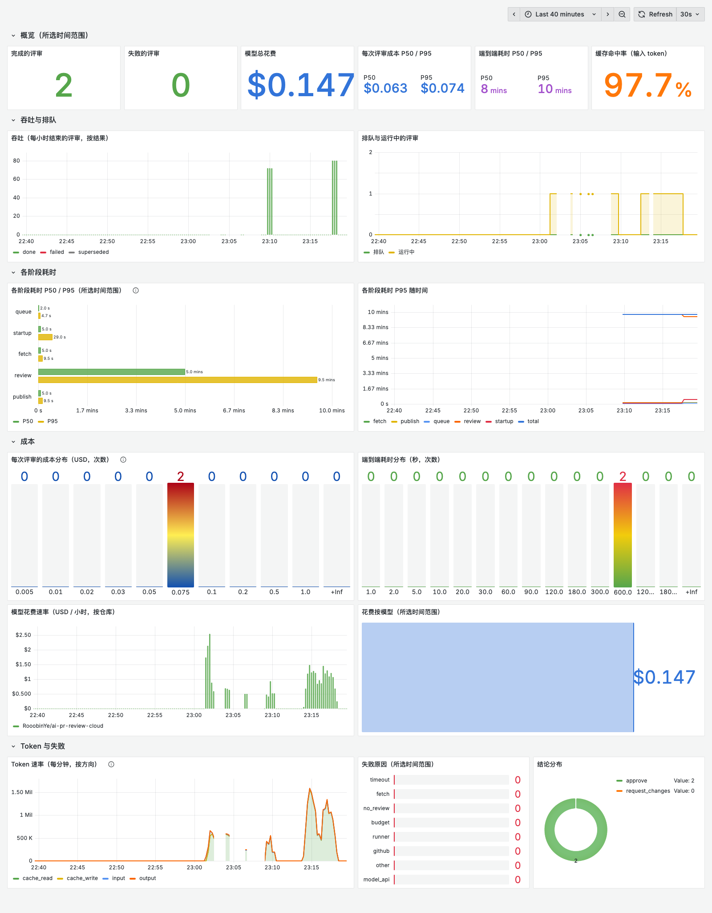

# 成本与延迟测算报告

> 对应赛题考核点 5（成本与性能），方法见 [架构 §7.2](architecture.md#72-成本测算方法)。数据测于 2026-10-23。

## 结论

- **一次评审的模型成本约 $0.03**：P50 $0.029，P95 $0.068，均值 $0.031。端到端 P50 106 秒，P95 224 秒。
- **中小 PR 的成本与 diff 大小关系很弱，取决于模型探索得多深。** 180 行的 chi#1148 平均 $0.049，1276 行、几乎全是删除的 ai-pr-review#13 只要 $0.017。只有最大的两个 PR（2153 行、4752 行）明显更贵，约 $0.06 到 $0.08。
- **前缀缓存把成本降到 1/4 到 1/7。** 93% 到 94% 的输入 token 命中 DeepSeek 的缓存（单价是未命中的 1/50）。
- **剩下的大头是输出（含思考）token**，占中小 PR 成本的约 65%。
- **软预算是性价比最高的优化**：预算 $0.02（花到 80% 时提示提交）让均值降 26%、P95 降 46%、轮数从 14.6 降到 10.0，20 个 PR 的结论与基线全部一致。降低思考强度（`low`）均值降 21%，但漏掉了一个基线三次都报出的问题。
- **每 100 个 PR 每月约 $9**：按每个 PR 平均评审 3 次估算，P95 口径约 $20。runner Pod 的算力成本在此之下一到两个数量级。
- **结论稳定**：20 个 PR 各跑 3 次，19 个三次结论一致；同一 PR 三次成本的变异系数中位数为 7%。

## 方法

| 项 | 取值 |
| --- | --- |
| 模型 | `deepseek/deepseek-flash`，thinking `high`（与 M0、M1 验收相同）；对照组只调整 flash 的参数 |
| 单价 | 每百万 token：输入 $0.30、缓存读取 $0.006、输出 $1.20（pi 模型目录） |
| 运行方式 | runner 本地模式（`--stats`），与集群模式共用同一评审流程（§4.2）；3 到 6 个并发 |
| PR | 20 个已合并或已关闭的真实 PR，按改动行数（增 + 删）分三档，见下表 |
| 次数 | 基线每个 PR 3 次（60 次），两组对照各 1 次（40 次），全部成功 |
| 驱动与汇总 | [`bench/run.mjs`](../bench/run.mjs)、[`bench/report.mjs`](../bench/report.mjs)；每次运行的原始数据在 [`bench/results/`](../bench/results/) |

本地模式测的是"拉取 PR + 克隆 + 模型评审"三段。集群里多出来的排队、建 Pod、投票三段由 controller 的指标记录，见下文"集群内实测"。

| 档位 | PR（改动行数） |
| --- | --- |
| 小（<100 行） | [ai-pr-review#17](https://github.com/RooobinYe/ai-pr-review/pull/17)（10）、[#12](https://github.com/RooobinYe/ai-pr-review/pull/12)（19）、[#5](https://github.com/RooobinYe/ai-pr-review/pull/5)（88）、[go-chi/chi#1097](https://github.com/go-chi/chi/pull/1097)（22）、[#1159](https://github.com/go-chi/chi/pull/1159)（45）、[#1218](https://github.com/go-chi/chi/pull/1218)（67）、[#1220](https://github.com/go-chi/chi/pull/1220)（98） |
| 中（100–500 行） | [ai-pr-review#15](https://github.com/RooobinYe/ai-pr-review/pull/15)（135）、[#8](https://github.com/RooobinYe/ai-pr-review/pull/8)（165）、[#11](https://github.com/RooobinYe/ai-pr-review/pull/11)（237）、[#9](https://github.com/RooobinYe/ai-pr-review/pull/9)（476）、[go-chi/chi#1148](https://github.com/go-chi/chi/pull/1148)（180）、[#1195](https://github.com/go-chi/chi/pull/1195)（249）、[#1214](https://github.com/go-chi/chi/pull/1214)（281） |
| 大（>500 行） | [ai-pr-review#14](https://github.com/RooobinYe/ai-pr-review/pull/14)（515）、[#10](https://github.com/RooobinYe/ai-pr-review/pull/10)（661）、[#13](https://github.com/RooobinYe/ai-pr-review/pull/13)（1276）、[#4](https://github.com/RooobinYe/ai-pr-review/pull/4)（3097）、[ai-pr-review-cloud#1](https://github.com/RooobinYe/ai-pr-review-cloud/pull/1)（2153）、[#2](https://github.com/RooobinYe/ai-pr-review-cloud/pull/2)（4752） |

## 基线结果

以下各表由 `node bench/report.mjs` 生成。

### 按改动规模分档

| 档位 | PR × 次数 | 改动行数 P50 | 成本 P50 | 成本 P95 | 成本均值 | 端到端 P50 | 端到端 P95 | 平均轮数 | 失败 |
| --- | --- | --- | --- | --- | --- | --- | --- | --- | --- |
| 小（<100 行） | 7 × 3 = 21 | 45 | $0.0258 | $0.0315 | $0.0213 | 121s | 219s | 12.8 | 0 |
| 中（100–500 行） | 7 × 3 = 21 | 237 | $0.0345 | $0.0522 | $0.0313 | 105s | 214s | 14.3 | 0 |
| 大（>500 行） | 6 × 3 = 18 | 1715 | $0.0357 | $0.0823 | $0.0430 | 98s | 225s | 16.9 | 0 |
| **全部** | 20 × 3 = 60 | 209 | $0.0294 | $0.0678 | $0.0313 | 106s | 224s | 14.6 | 0 |

### 时间和 token 花在哪里

| 档位 | 拉取 + 克隆 | 评审（模型） | 工具调用 | 未缓存输入 | 缓存读取 | 缓存命中率 | 输出 | 输出占成本 | 无缓存时成本 | 实际成本 |
| --- | --- | --- | --- | --- | --- | --- | --- | --- | --- | --- |
| 小（<100 行） | 5s | 109s | 23.1 | 17.1k | 215.7k | 93% | 12.4k | 65% | $0.0847 | $0.0213 |
| 中（100–500 行） | 5s | 105s | 25.3 | 30.0k | 399.5k | 93% | 16.6k | 64% | $0.1487 | $0.0313 |
| 大（>500 行） | 5s | 117s | 30.8 | 53.1k | 852.4k | 94% | 18.3k | 49% | $0.2936 | $0.0430 |

"无缓存时成本"一列把缓存读取的 token 按未命中单价重新计价，用来估算关闭前缀缓存时的成本。

### 稳定性与结论质量

- 20 个 PR 中有 19 个三次结论一致。唯一的例外是 ai-pr-review-cloud#1（2153 行，M0 的 PR）：approve / request_changes / approve。
- 结论与 PR 的实际情况相符。故意带安全问题的 [ai-pr-review#15](https://github.com/RooobinYe/ai-pr-review/pull/15)（标题写明 DO NOT MERGE）三次都是 request_changes，平均 3.7 条 critical/high 评论；go-chi/chi 的 7 个已合并 PR 全部 approve，没有 critical/high 评论。

## 瓶颈分析

**模型评审占端到端时间的 95% 以上。** 拉取 PR 和克隆合计约 5 秒，其余时间都是模型的多轮探索：平均 14.6 轮、26 次工具调用。

**成本近似等于"轮数 × 每轮的上下文与思考量"，diff 只占首轮输入的一部分：**

| PR | 改动行数 | 平均轮数 | 平均成本 | 说明 |
| --- | --- | --- | --- | --- |
| go-chi/chi#1148 | 180 | 17.7 | $0.049 | 路由树的冲突处理；一次运行里 `tree.go` 读了 5 次，输出约 3 万 token |
| ai-pr-review#13 | 1276 | 15.0 | $0.017 | 几乎全是删除，输出只有约 4.5k token |
| ai-pr-review-cloud#2 | 4752 | — | $0.082 | 50 个文件，首轮 diff 本身就有几万 token |

**架构 §7.2 预计的"上下文膨胀"大部分被前缀缓存消化了。** 每轮新增的只是上一轮的工具结果，前面的内容都命中缓存。真正的成本来自输出：deepseek-flash 的输出单价是输入的 4 倍、缓存读取的 200 倍，而 `high` 思考强度下每轮都会产生几百到上千 token 的推理。

## 优化对比

在同一批 20 个 PR 上，每种方案各跑 1 次：

| 方案 | 次数 | 成本均值 | 成本 P50 | 成本 P95 | 端到端 P50 | 端到端 P95 | 平均轮数 | 与基线多数结论一致 | 每次 critical+high 评论 | 触发预算提示 | 失败 |
| --- | --- | --- | --- | --- | --- | --- | --- | --- | --- | --- | --- |
| 基线（每 PR 3 次） | 60 | $0.0313 | $0.0294 | $0.0678 | 106s | 224s | 14.6 | 59/60 | 0.78 | 0 | 0 |
| `budget-0.02`：软预算 $0.02（§7.3） | 20 | $0.0233 | $0.0213 | $0.0366 | 74s | 361s | 10.0 | 20/20 | 0.85 | 15 | 0 |
| `thinking-low`：`LLM_THINKING=low` | 20 | $0.0248 | $0.0204 | $0.0446 | 83s | 180s | 13.3 | 19/20 | 0.65 | 0 | 0 |
| 关闭前缀缓存（估算） | — | 约 $0.17 | — | — | — | — | — | — | — | — | — |

- **软预算**：均值降 26%，P95 降 46%，主要压住了大 PR 的长尾（ai-pr-review-cloud#2 从 $0.082 降到 $0.035）。结论 20/20 与基线一致，critical/high 评论数没有减少。触发提示的 15 次中，多数最终花费在 $0.019 到 $0.030 之间，也就是超出阈值一到两轮，与 §7.3 的预期相符。例外是 go-chi/chi#1218：最终花费 $0.071、耗时 971 秒，提示触发时已经花了 $0.067。那一次单轮输入有 18 万未命中缓存的 token，一轮就超出了预算。软上限按轮检查，管不住单轮的花费，所以仍然需要 M2 的硬上限（LiteLLM `max_budget`）。这一次也是该组端到端 P95 偏高的原因。
- **降低思考强度**：均值降 21%，但 critical/high 评论减少 17%。基线三次都判为 request_changes 的 ai-pr-review#11 在这一组被判为 approve，也没有提出那条 high 问题。
- **前缀缓存**：DeepSeek 默认开启，无法关闭，不需要单独跑。上表按单价估算了关闭时的成本，大约是现在的 4 到 7 倍。
- **没有做的对比**：更大的模型（`deepseek-v4-pro`）按要求没有跑。"小模型探索、大模型下结论"也没有做：当前流程中探索和提交发生在同一个 agent 循环里，拆成两个模型需要改评审流程，而且成本主要来自输出 token、不是长上下文的输入，收益有限。

**建议**：保持 `high` 思考强度，用软预算控制长尾。chart 当前默认的 `runs.budgetUSD` 是 $0.5，提示阈值 $0.4 永远不会触发；测算支持把它降到 $0.05 左右，只影响最大的那些 PR。但 M2 会用同一个值作为硬上限，调整时要和 M2 一起定。

## 集群内实测

在独立的 Kind 集群上，对本 PR（ai-pr-review-cloud#4，约 30 个文件）的两个提交各跑了一次完整的闭环：webhook → 排队 → Job → 评审 → 投票。数据取自 controller 的数据库，与看板一致：

| 提交 | 结论 | 排队 | 建 Pod | 拉代码 | 模型评审 | 投票 | 合计 | 成本 | 轮数 |
| --- | --- | --- | --- | --- | --- | --- | --- | --- | --- |
| 55c7d10 | approve | 1.7s | 2.5s | 4.0s | 500s | 5.5s | 514s | $0.071 | 20 |
| 027a110 | approve | 4.1s | 27.9s | 9.0s | 280s | 4.2s | 325s | $0.075 | 39 |

除模型评审外，各阶段合计在 15 到 45 秒之间；建 Pod 的 27.9 秒出现在本机同时运行 6 个测算进程时。模型评审偏长，一方面是 PR 本身大，另一方面这两次评审与测算共用同一个 DeepSeek 账户。



截图是这两次评审结束后最近 40 分钟的看板。看板上的分位数按直方图的桶插值，样本少时只能看量级。截图之后，吞吐和花费两个面板从"按小时折算的速率"改成了"每 5 分钟的增量"：样本很少时，前者会把一次评审放大成每小时几十次。

## 每 100 个 PR 的月成本

| 口径 | 每次评审 | 每 PR 评审 1 次 | 每 PR 评审 3 次 |
| --- | --- | --- | --- |
| 均值 | $0.031 | $3.1 | $9.4 |
| P95 | $0.068 | $6.8 | $20.3 |
| 均值，软预算 $0.02 | $0.023 | $2.3 | $7.0 |

"每 PR 评审 3 次"对应一次打开加两次推送：每个新的 `head_sha` 评审一次（§3），M1 实测的 PR 就是这个节奏。算力方面，runner Pod 申请 250m CPU、512Mi 内存，每次约 2 分钟，300 次评审合计约 2.5 vCPU·小时，按常见云厂商的价格不到 $0.2。gateway、controller、PostgreSQL 和监控是固定开销，与评审次数无关。

## 复现

```bash
node --env-file=.env bench/run.mjs --variant baseline --runs 3
```

```bash
node bench/report.mjs
```

`.env` 里需要 `LLM_API_KEY`；`GITHUB_TOKEN` 缺省时取 `gh auth token`。已有结果的运行会被跳过，被模型服务拒绝的运行（`model API error`）会重跑。对照组用 `--variant <名称>` 加 `--thinking`、`--budget`、`--model` 参数。

## 局限

- 每档只有 6 到 7 个 PR，P95 是 18 到 21 个样本插值得到的，只能看量级。对照组每个 PR 只跑了 1 次，单个 PR 的差异含有随机波动（基线中同一 PR 三次成本的变异系数中位数为 7%）。
- PR 来自三个 Go 仓库（其中两个是本项目和它的前身），没有覆盖前端仓库或大型单体仓库。
- 测算时多个 runner 共用一个 DeepSeek 账户并发运行，耗时里包含模型 API 在这种负载下的排队。
- 金额按 pi 模型目录的单价计算，没有与 DeepSeek 账单逐笔核对；M2 接入 LiteLLM 后可以用它的花费统计交叉校验。
- 测算途中账户余额耗尽过一次，受影响的运行都已删除并在充值后重跑，见 [roadmap 的 M6 记录](roadmap.md#m6-成本看板与测算报告)。
