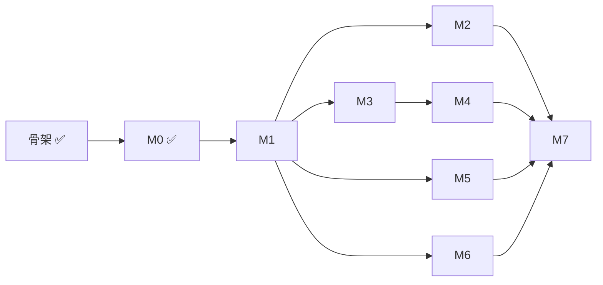

# Roadmap

按里程碑推进 [架构设计](architecture.md) 的实现。每个里程碑都以一个可演示的验收标准收尾；完成后在总览里更新状态。

## 总览

| 阶段 | 内容 | 验收标准 | 状态 |
| --- | --- | --- | --- |
| [骨架](#骨架) | 仓库结构、4 个镜像、Helm chart、Makefile、CI；gateway 签名校验；状态机与表结构 | `make lint`、`make test` 通过；Kind 上 4 个 Pod 就绪；签名正确的 webhook 返回 202，错误返回 401 | ✅ 完成 |
| [M0](#m0-runner-本地模式) | runner 本地模式：pi SDK + 重写的提示词 + `submit_review` | 对 3 个历史 PR 输出合法的 schema v3 JSON，质量不低于 v1 | ✅ 完成 |
| [M1](#m1-最小闭环) | 最小闭环：gateway 写库 + controller 建 Job + fetch 拉代码，Kind 上跑通 | 开 PR 后自动出现 Check Run 和评审评论；结论为 approve 时 AI 投出的 APPROVE 计入必需审批数 | ✅ 完成 |
| [M2](#m2-安全边界) | 安全边界：LiteLLM 虚拟 key、NetworkPolicy | runner 容器里 `env` 看不到任何真实密钥；`curl` 外网失败 | ✅ 完成 |
| [M3](#m3-可靠性) | 可靠性：幂等、session 快照恢复、superseded | 评审中途 `kubectl delete pod`，run 自动恢复且 PR 上没有重复评论 | ✅ 完成 |
| [M4](#m4-仓库配置与可选合并模式) | 仓库配置与可选合并模式（默认 vote 只投票） | 默认只投票不合并；auto 模式下 approve 后自动合并；manual 模式下等待期间无 runner Pod，`/merge` 后合并 | 未开始 |
| [M5](#m5-预览环境验证) | 预览环境验证 | 故意提交一个探针配置错误的 PR，agent 通过 kubectl 发现并给出 request_changes | 未开始 |
| [M6](#m6-成本看板与测算报告) | 成本看板与测算报告 | Grafana 看板 + 成本测算结果 | ✅ 完成 |
| [M7](#m7-参赛交付) | 参赛交付：演示视频、文档定稿 | 评委按 README 能在本机复现，视频覆盖完整闭环 | 未开始 |

## 依赖关系

M1 之后，M2、M3、M5、M6 可以并行。M5 依赖 demo 仓库自己的 CI 推送镜像，这部分准备工作可以更早开始。

## 骨架

已完成：

- Go module：gateway（webhook 签名校验、`pull_request` 触发解析）、controller 与 fetch 的入口、run 状态与合法转换、PostgreSQL 表结构。
- runner：pi SDK `1.3.0` 精确锁定，集群模式与本地模式入口，PR URL 解析。
- 镜像：Go 三个组件共用一个多阶段 Dockerfile（distroless nonroot），runner 基于 Node 24 slim。
- Helm chart：gateway、controller、controller 的最小 Role、webhook secret、开发用 PostgreSQL。
- `make test`、`make lint`、`make images`、`make kind-up`、`make deploy`；GitHub Actions CI。

## M0 runner 本地模式

目标：不依赖集群，`runner --pr <url>` 就能产出一份质量不低于 v1 的评审。

- [x] `runner/src/schema.ts`：用 TypeBox 定义评审结论。设计调整为 schema v3：模型直接给出 `verdict` 并写评审正文，结构只保留 `comments` 的 `path`、`line`、`severity`、`confidence`（见架构 §4.4）。
- [x] `runner/src/prompts.ts`：按 v1 的防幻觉规则重写系统提示词和用户提示词，新增判定规则和不可信输入说明。
- [x] 本地模式拉取 PR 元信息和 diff，部分克隆到临时目录。
- [x] 接入模型：DeepSeek 是 pi 内置 provider，`LLM_BASE_URL` 覆盖地址；非内置 provider 按 OpenAI 兼容接口注册（架构 §4.5）。
- [x] `submit_review` 工具：校验评论锚点落在 diff 内；模型未调用时最多追加 2 次提示。
- [x] 输出 `--format markdown|json`；结束时打印 token 和金额。
- [x] Go 侧定义同一份 schema（`go/internal/review`），`contract/` 下的生成 schema 与样例由 Go / TS 两侧测试共同校验。
- [x] 核对 pi `usage` 是否包含 cache 相关字段：包含 `cacheRead`、`cacheWrite`，DeepSeek 会填充 `cacheRead`。
- [x] 评审阶段用只读 `git` 工具代替 `bash`；不加载被评审仓库里的扩展和 `AGENTS.md`。

验收：对 3 个历史 PR 输出通过 schema 校验的 JSON，人工对比结论质量不低于 v1。

验收记录（2026-10-23，`deepseek/deepseek-flash`，thinking high；v1 使用同一模型，经 DeepSeek 的 Anthropic 兼容接口）：

| PR | 本项目结论 | 耗时 / 花费 | v1（同模型） | 对比 |
| --- | --- | --- | --- | --- |
| [ai-pr-review#15](https://github.com/RooobinYe/ai-pr-review/pull/15)：带安全问题的 webhook | request_changes，10 条评论（3 critical） | 70s / $0.020 | 9 条 must_fix，68s | 两边都找到硬编码密钥、两处 shell 注入、`rm -rf` 空路径、world-writable 权限、CI 中 PR 代码可读密钥 |
| [ai-pr-review#14](https://github.com/RooobinYe/ai-pr-review/pull/14)：JSON 输出与 `--fail-on` | request_changes，10 条评论（2 high） | 79s / $0.025 | 8 条 must_fix，205s | 共同发现 `--fail-on` 在写 `--output` 前退出（已对照源码确认）、拼错阈值时门禁失效、`pr_info` 字段为大驼峰、前置失败没有 JSON 输出；双方各有 3 到 4 条对方没有的有效发现 |
| [ai-pr-review#12](https://github.com/RooobinYe/ai-pr-review/pull/12)：Windows 控制台 API 修复 | approve，4 条 medium/low 评论 | 71s / $0.021 | 无 must_fix，136s | 结论一致；两边都指出 CI 里重复维护的 Go 版本 |

三个 PR 的结论与 v1 一致（v1 有 must_fix 即视为 request_changes），关键问题覆盖相当，单次耗时更短。所有输出通过 schema 校验，`submit_review` 都是一次调用成功，没有触发提醒。

## M1 最小闭环

目标：真实 PR 触发，结果出现在 GitHub 上。

- [x] 注册 demo 用的 GitHub App；本地 Kind 通过 webhook 转发工具（如 smee 或 cloudflared）接收事件。
- [x] GitHub App 认证：App JWT 换取 installation token。
- [x] controller 启动时执行 `store.Migrations`。
- [x] gateway 写入 `review_run`（按 delivery ID 去重，`(repo, pr, head_sha)` 唯一）。
- [x] controller 用 `SELECT ... FOR UPDATE SKIP LOCKED` 领取 run，创建 Job（fetch init 容器 + runner）。
- [x] fetch：浅克隆 head、拉取 base、写出 `/workspace/pr.json`。
- [x] runner 集群模式：读取 `/workspace`，结果回调 `POST /runs/{id}/result`。
- [x] controller 创建 Check Run，发布 PR Review 投票（默认 `vote` 模式，见架构 §6.3）：正文加逐行评论，结论为 approve 时事件为 APPROVE，否则为 COMMENT，`commit_id` 取结果里的 `head_sha`；每个写操作记录到 `github_action`。
- [x] 同一 PR 的新 `head_sha` 到达时，dismiss bot 在该 PR 上仍然有效的 APPROVE；`github_action` 增加对应类型。
- [x] 实测 bot 的 APPROVE 是否计入"需要 N 个 approval"，以及 App 能否 dismiss 自己的 review；结果写回架构 §10。

验收：在 demo 仓库开 PR，几分钟内出现 "AI Review" Check Run 和评审评论；在要求 2 个审批的分支上，AI approve 加一个人的 approve 即可合并，有问题的 PR 只收到 COMMENT、不被阻塞。

验收记录（2026-10-23，本仓库 [PR #2](https://github.com/RooobinYe/ai-pr-review-cloud/pull/2)，`deepseek/deepseek-flash`，thinking high）：

| 触发 | 结果 | 耗时 / 花费 |
| --- | --- | --- |
| reopen，head `6b4558b` | COMMENT + 6 条逐行评论（1 high：`reviewed` 状态遇确定性错误会无限重试），Check Run neutral | 约 3 分钟（评审 187s） / $0.075 |
| push `3faaca9`（修复上一轮） | APPROVE + 3 条评论，Check Run success | 约 4 分钟 |
| push `fa417f4` | 先 dismiss `3faaca9` 上的 APPROVE（状态变为 DISMISSED），再 APPROVE + 6 条评论 | 约 4 分钟 |

AI 的发现中有一个安全问题（回调未鉴权，可伪造结论让 bot 投出 APPROVE），因此把 M2 的 `RUN_TOKEN` 提前到 M1；Job 创建前的 Kubernetes 错误没有时限，留到 M3 的超时与重试上限一并处理。runner 容器的环境变量里没有 GitHub token。

审批计数：仓库改为公开后，在 `main` 上开启"要求 1 个审批"。App 只有 Contents: read 时，bot 的 APPROVE 不计入（`REVIEW_REQUIRED`）；把 App 权限改为 Contents: write 并在安装上接受后，同一张票立即计入（`APPROVED`，可合并）。"AI 加一个人"的 2 票场景需要第二个人类账号，留到 M7 演示。

评论数量：前几轮每次 3 到 6 条逐行评论，偏多。提示词改为只对合并前值得处理的问题留逐行评论（通常 0 到 5 条），低级别建议并入正文的 "Minor"。

## M2 安全边界

2026-10-24 最新 main 的 [Kind 整合验收](kind-integration-acceptance.md) 已跑通 M2/M3/M6 主流程；发现旧 M2 环境同样存在的 kindnet Pod 启动隔离窗口，稳态外网阻断通过，但启动瞬间隔离仍待解决。

目标：模型和 runner 拿不到任何真实凭据，也连不上外网。

- [x] chart 加入 LiteLLM proxy（`v1.104.2`），真实模型 key 只放在 proxy 里。
- [x] controller 为每个 run 签发带 `max_budget` 的虚拟 key，存进本 run 的 Secret，run 结束吊销；key 另设到期时间兜底。
- [x] 每个 run 生成独立的回调 token（`RUN_TOKEN`），controller 校验。（M1 提前实现：伪造的结论能让 bot 投出计入审批数的 APPROVE）
- [x] runner 的 NetworkPolicy：出站只允许 DNS、LiteLLM、controller。策略对整个 Pod 生效，fetch 改为经 controller 的 CONNECT 代理访问 GitHub，凭据只注入 fetch（架构 §4.1）。
- [x] 验证 `max_budget` 超出后 proxy 拒绝请求，run 以 `failed(budget_exceeded)` 结束。

验收：在 runner 容器里执行 `env` 看不到真实密钥；`curl` 任意外网地址失败。

验收记录（2026-10-23，Kind，单独的 `ai-pr-review-m2` namespace，LiteLLM `v1.104.2`，评审对象为本仓库 [PR #5](https://github.com/RooobinYe/ai-pr-review-cloud/pull/5)）：

| 检查 | 结果 |
| --- | --- |
| fetch 经 controller 代理拉代码 | 第一次失败：libcurl 对不带端口的代理地址默认用 1080；改为显式端口后，`api.github.com` 和 `github.com` 都经代理访问成功 |
| runner 容器的 `env` | 只有 `LLM_API_KEY`（25 个字符的 LiteLLM 虚拟 key）和 `RUN_TOKEN` 两个凭据；没有 GitHub token、代理凭据、App 私钥、webhook secret、master key |
| runner 容器访问外网 | `https://example.com`、`https://api.github.com`、`http://1.1.1.1`、`https://api.deepseek.com` 全部超时；controller 和 LiteLLM 可达（runner 镜像没有 curl，用 `node` 的 `fetch` 测） |
| runner 容器使用 controller 的代理 | 不带凭据 407；用 `RUN_TOKEN` 或虚拟 key 冒充代理凭据 403 |
| 预算 | 预算为 0 的 run：LiteLLM 拒绝第一个请求，run 以 `failed`、原因 `budget_exceeded: ...` 结束，Check Run 显示同一原因；本地对 mock 上游验证了花费累积到上限后拒绝 |
| 吊销 | 上面两次失败的 run 结束后，LiteLLM 里不再有有效 key |
| 经 LiteLLM 调用 DeepSeek | 初次因账户余额不足返回 402；充值后首轮在 197 秒因 proxy 探针重启中断。修复探针后完整评审通过，见下方补测记录 |

补测（2026-10-24，北京时间；同一 namespace，PR #5 head `65ec539`）：run `157416dc-3c28-40a1-a31e-de74e8955a66` 完成，经 LiteLLM 的流式输出、thinking、工具调用和 `submit_review` 全链路成功。模型耗时 258 秒、花费 $0.0880，最终 `done / approve`，GitHub review `5630996582` 为 APPROVED，Check Run `120514245680` 为 success。LiteLLM 全程 0 次重启，结束后当前 run 的虚拟 key 已删除；旧失败 run 遗留 key 已过期，无有效 key 遗留。

本次复测确认 runner 的凭据环境变量仅 `LLM_API_KEY`（25 字符虚拟 key）和 `RUN_TOKEN`；四个外网目标全部超时，controller 和 LiteLLM 健康接口均返回 200。代理凭据隔离沿用首次 407/403 验收及 `TestEgressProxy` 单元测试，本次未重复执行真实凭据冒充探测。完整评审提出一条 medium：Secret 创建响应丢失时不应吊销可能已经被 Pod 使用的 key；已修复并用 `TestLostSecretResponseKeepsUsableKey` 覆盖。`make test`、`make lint` 和连接真实 PostgreSQL 的 store 测试通过。

## M3 可靠性

- [x] 整理 M2/M3 与既有测试的重复覆盖：合并 Secret 重建、用量 API 和已提交评审恢复场景，保留 key 更新、输入校验及路径规范化断言。

M2 与 M3/M6 整合验收（2026-10-24）：重试 key 的预算扣除已上报的跨轮花费，预算耗尽不签发新 key；重试、超时及 superseded 在删除旧 Job/Secret 前吊销 key。对应控制器回归测试、真实 PostgreSQL 用量汇总测试以及 runner 的预算错误/恢复测试通过。未上报的崩溃窗口花费不在扣减数内，限制见架构 §7.3。

目标：任何组件在任何时刻崩溃，评审都能继续且不产生重复的 GitHub 副作用。

- [x] runner 每轮结束上传 session 快照（`PUT /runs/{id}/session`）和用量（`PUT /runs/{id}/usage`，含缓存读写 token）。
- [x] Pod 失败时 controller 放回 `queued`、`attempt + 1`；新 Pod 取回快照，用 `SessionManager.inMemory(cwd, undefined, entries)` 恢复（不落盘，效果同 `open`）。快照里已有被接受的 `submit_review` 时直接上报，不再调用模型。
- [x] 不丢 webhook：gateway 的就绪检查确认最新迁移已执行；controller 每 5 分钟列出 App 的近期 delivery，重投失败的那些（gateway 按 delivery ID 去重）。
- [x] 同一 PR 的新提交评审时，把 bot 之前的逐行评论（及是否已解决、是否过时）写进 `pr.json`，提示模型不要重复已提过的问题，只说新问题和仍未修复的问题。
- [x] 同一 PR 推送新提交时，旧 run 标记为 `superseded`，删除 Job，Check Run 完成为 `cancelled`。
- [x] Job 超时（`activeDeadlineSeconds`）与总重试上限（`runs.maxAttempts`，默认 3），失败原因写到 Check Run；确定性失败用退出码 3 标记，不重试；从领取起超过时限的尝试也会失败，覆盖 Job 建不出来的情况（M1 遗留）。
- [x] controller 重启后从数据库恢复所有进行中的 run；写 GitHub 之前先查是否已写过（Check Run 按 `external_id`，投票按正文里的 run 标记），补上"写成功、回填前崩溃"的窗口（M1 遗留）。
- [x] 针对上述每种故障的测试：controller 用内存假实现逐个模拟（`go/internal/controller/recovery_test.go`），runner 用 pi 的 faux 模型验证续跑（`runner/src/review.test.ts`），store 在 PostgreSQL 上验证；丢 Pod 的场景另在 Kind 上实测（见下）。

验收：评审进行中 `kubectl delete pod`，run 自动恢复完成，PR 上没有重复评论。

第一次验收（2026-10-23，本仓库 [PR #3](https://github.com/RooobinYe/ai-pr-review-cloud/pull/3)，`deepseek/deepseek-flash`，thinking high）：

| 时间（UTC） | 事件 |
| --- | --- |
| 14:19:36 | 第 1 次尝试的 Job 创建，Check Run 进入 in_progress |
| 14:20:16 | 快照已到第 9 轮（249 KB，9 行用量），`kubectl delete pod` |
| 14:20:49 | Job 变为 Failed（`BackoffLimitExceeded`）；宽限期内 runner 又上传到第 13 轮 |
| 14:20:53 | controller 判定可重试，放回 `queued`，Check Run 显示"第 2 次尝试" |
| 14:20:54 | 第 2 次尝试领取，新 Job、新 Secret、新 token |
| 14:21:02 | 新 Pod 取回第 13 轮的快照（38 个 entry），带着前 13 轮的上下文继续探索 |
| 14:22:33 | 模型账户先后返回 429（并发超限）和 402（余额不足），run 以 `failed` 结束 |

恢复链路按设计工作：两次尝试共用同一个 Check Run，用量按轮次累计到 28 行、$0.0526，PR 上没有出现第二个 Check Run。评审没能走完是因为模型账户余额耗尽，所以"恢复后完成并且没有重复评论"这一条还要在充值后重新验收。

这次失败暴露了一个问题：请求失败后的那一轮被当成"模型没调用 `submit_review`"，用掉两次提醒后以退出码 3 结束，不会再重试。已改为：最后一次模型回复是错误时抛出 `ModelRequestError`，以退出码 1 退出，由 controller 重试。

实测发现：Node 作为 PID 1 不处理 SIGTERM，被删的 Pod 会跑满 30 秒宽限期（期间快照从第 9 轮推进到第 13 轮）才被杀掉。对恢复无害，但被 `superseded` 的 run 会白花 30 秒的 token，所以 runner 改为收到 SIGTERM 立即以 143 退出（可重试）。

补充验收（2026-10-23 UTC，2026-10-24 核对数据库与 GitHub）：充值后的 run `9bfd1d86-4b08-4ed7-bf75-23723874a7c6` 评审 [PR #3](https://github.com/RooobinYe/ai-pr-review-cloud/pull/3)，head `86c2c09`。Claude session 记录 15:12:28 在第 5 轮删除 `review-9bfd1d86-4b08-4ed7-bf75-23723874a7c6-1-dgx7t`；数据库记录因 `BackoffLimitExceeded` 重试，最终 `attempt=2`、`state=done`，于 15:15:50 完成。最终快照为第 25 轮，用量 25 行、$0.062059704。GitHub 上该 run 只有一个 Check Run（`120491023505`，neutral），一条带 run 标记的 Review（`5630382577`，COMMENT）；数据库的创建/完成 Check 操作指向同一 ID。恢复后完整评审且不重复写入的验收通过。

验收评审指出的两项有效问题已补齐：发布结果时也找回尚未回填 ID 的 Check Run，避免结果抢先到达后留下永久 `in_progress`；每轮先上报用量，再独立上传快照，避免快照拒绝时漏记已花费用量。与 M6 合并保留成本指标、预算提醒和统计输出；迁移覆盖新库、M3-only、M6-only 升级路径，并检查全部迁移后才就绪。相应恢复、路径规范化、用量上传和数据库升级测试均已加入。

## M4 仓库配置与可选合并模式

目标：默认的 `vote` 模式只投票、不合并；仓库可以选择让 AI 结论驱动合并，等待人工时不占算力。

- [ ] 解析仓库根目录的 `.ai-pr-review.yaml`（`approvalMode`、`failOn`、`budgetUSD`、`language`），缺省时 `approvalMode` 为 `vote`。
- [ ] `failOn` 校验：存在 `severity` 达到阈值的评论时，把 approve 改写为 request_changes，即只发 COMMENT、不投 APPROVE。
- [ ] `decideMerge` 与 auto 模式的合并执行。
- [ ] manual 模式：进入 `awaiting_approval`，接收 `/merge` 评论和人工 approve（`issue_comment`、`pull_request_review` 事件）。

验收：没有配置文件时只投票不合并；auto 模式下 approve 后自动合并；manual 模式下等待期间没有 runner Pod，评论 `/merge` 后合并。

## M5 预览环境验证

目标：把运行时证据纳入评审结论。

- [ ] demo 仓库的 CI 为每个 PR 推送 `:<head_sha>` 镜像。
- [ ] controller 增加只含 `namespaces` 的 ClusterRole；为 PR 创建 `pr-<owner>-<repo>-<n>` namespace 并配 ResourceQuota。
- [ ] 按 `.ai-pr-review.yaml` 的 `preview` 配置用 Helm 部署，等待 Ready 或超时。
- [ ] runner 镜像加入 kubectl；预览阶段使用只能读该 namespace 的 ServiceAccount。
- [ ] runner 收到 follow-up 提示后用 kubectl 检查 Pod、事件、日志。
- [ ] PR 关闭时删除 namespace；定时清理超过 24 小时的孤儿 namespace。

验收：提交一个探针配置错误的 PR，agent 通过 kubectl 发现问题并给出 request_changes。

## M6 成本看板与测算报告

目标：回答赛题考核点 5（成本与性能）。

- [x] controller 暴露 `/metrics`（run 数、各阶段耗时、队列深度、token、金额）：抓取时由数据库计算；runner 每轮上报用量（`PUT /runs/{id}/usage`），各阶段时间戳记在 `review_run`（架构 §7.1）。
- [x] 部署 Prometheus 与 Grafana，提交看板 JSON：chart 的 `monitoring.dev`，看板在 `deploy/helm/ai-pr-review-cloud/dashboards/`。
- [x] runner 在花费达到预算 80% 时追加提示，要求尽快提交结论（架构 §7.3）。
- [x] 按架构设计 §7.2 的方法测算 20 个 PR，输出成本与延迟报告和优化对比：见 [cost-report.md](cost-report.md)（基线 20 × 3 次，软预算、低思考强度两组对照各 20 次，只用 flash）。
- [x] 在 Kind 上跑真实评审，确认看板各面板有数据并截图：本 PR 的两个提交各跑一次完整闭环。

验收：Grafana 看板能展示吞吐、各阶段耗时分布、每 PR 成本分布；测算报告入库到 `docs/`。

验收记录（2026-10-23，`deepseek/deepseek-flash`，thinking high）：

解决了什么：

- 成本可见：每次评审的 token、金额、各阶段耗时进入数据库，`/metrics` 由数据库计算（controller 重启不丢计数），Grafana 看板随 `make deploy` 一起装好。
- 成本可量化：一次评审 P50 $0.029、P95 $0.068，端到端 P50 106 秒；每 100 个 PR 每月约 $9（每 PR 评审 3 次）。模型评审占端到端时间的 95% 以上，成本主要来自输出 token，前缀缓存已把输入成本压到原来的约 1/4 到 1/7。
- 成本可控：花费达到预算 80% 时提示模型提交。预算 $0.02 时均值降 26%、P95 降 46%，结论与基线 20/20 一致。
- 失败可诊断：测算途中 DeepSeek 余额耗尽（402），暴露出两个问题，都已修复。一是 runner 把模型服务拒绝调用误报成"模型没有提交"，现在直接以 `model API error` 失败。二是 controller 截断容器日志时丢掉了最后一行（致命错误），现在保留日志末尾，失败原因按最后一行归类，并新增 `model_api`。
- 根据 AI 评审意见修复：测算续跑时被模型服务拒绝的运行会重跑；stats 写入失败不再掩盖真实错误。

没解决的：

- 软预算按轮检查，管不住单轮的花费：go-chi/chi#1218 在一轮里花到了 $0.067，最终 $0.071。硬上限依赖 M2 的 LiteLLM `max_budget`。
- chart 默认的 `runs.budgetUSD` 是 $0.5，提示永远不会触发。测算支持降到 $0.05 左右，但 M2 会用同一个值作为硬上限，留到 M2 一起定。
- 指标在每次抓取时扫描所有 done run，run 多了以后要改为只看一个时间窗口，或在状态转换时累加。
- 集群内只跑了 2 次完整评审，看板上的分位数只能看量级；更大样本留到 M7 演示时积累。
- 没有对比更大的模型（按要求只用 flash），也没有做"小模型探索、大模型下结论"（需要改评审流程）。
- 金额按 pi 模型目录的单价计算，还没与账单或 LiteLLM 的花费交叉核对（M2）。

## M7 参赛交付

目标：满足赛题考核点 4（工程完成度与 Demo 表现）。

- [ ] README 的快速开始从零验证一遍（全新机器或全新 Kind 集群）。
- [ ] 架构设计定稿，补充关键技术选型理由。
- [ ] 录制演示视频：开 PR → 评审 → 预览验证 → AI 投票并与人工审批一起满足合并要求（再演示一次 auto 模式自动合并）；穿插一次 Pod 崩溃恢复和成本看板。
- [ ] 发布镜像与 chart 的版本 tag。

验收：评委按 README 能在本机复现；视频覆盖"发现 → 分析 → 定位 → 修复建议 → 验证"的完整闭环。
