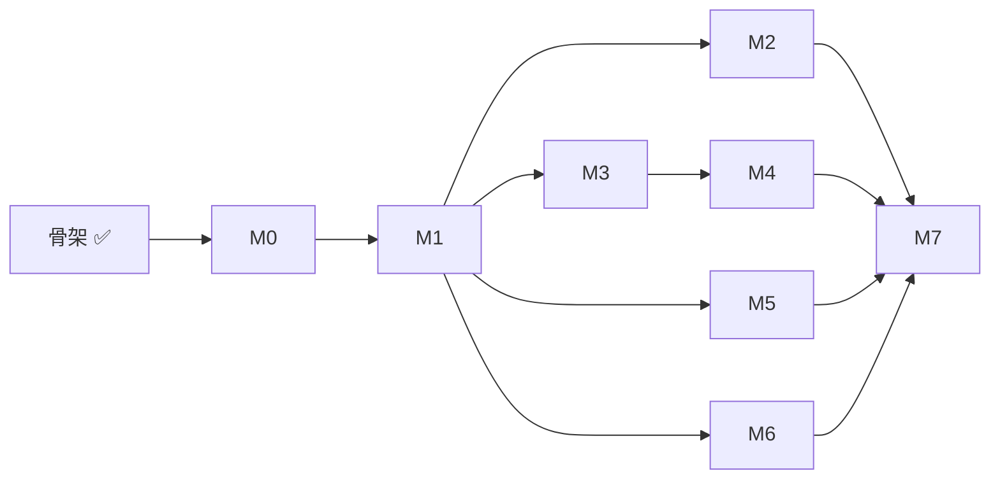

# Roadmap

按里程碑推进 [架构设计](architecture.md) 的实现。每个里程碑都以一个可演示的验收标准收尾；完成后在总览里更新状态。

## 总览

| 阶段 | 内容 | 验收标准 | 状态 |
| --- | --- | --- | --- |
| [骨架](#骨架) | 仓库结构、4 个镜像、Helm chart、Makefile、CI；gateway 签名校验；状态机与表结构 | `make lint`、`make test` 通过；Kind 上 4 个 Pod 就绪；签名正确的 webhook 返回 202，错误返回 401 | ✅ 完成 |
| [M0](#m0-runner-本地模式) | runner 本地模式：pi SDK + 重写的提示词 + `submit_review` | 对 3 个历史 PR 输出合法的 schema v2 JSON，质量不低于 v1 | 未开始 |
| [M1](#m1-最小闭环) | 最小闭环：gateway 写库 + controller 建 Job + fetch 拉代码，Kind 上跑通 | 开 PR 后自动出现 Check Run 和评审评论 | 未开始 |
| [M2](#m2-安全边界) | 安全边界：LiteLLM 虚拟 key、NetworkPolicy | runner 容器里 `env` 看不到任何真实密钥；`curl` 外网失败 | 未开始 |
| [M3](#m3-可靠性) | 可靠性：幂等、session 快照恢复、superseded | 评审中途 `kubectl delete pod`，run 自动恢复且 PR 上没有重复评论 | 未开始 |
| [M4](#m4-自动合并与-manual-模式) | 自动合并与 manual 模式 | auto 模式下 approve 后自动合并；manual 模式下等待期间无 runner Pod，`/merge` 后合并 | 未开始 |
| [M5](#m5-预览环境验证) | 预览环境验证 | 故意提交一个探针配置错误的 PR，agent 通过 kubectl 发现并给出 request_changes | 未开始 |
| [M6](#m6-成本看板与测算报告) | 成本看板与测算报告 | Grafana 看板 + 成本测算结果 | 未开始 |
| [M7](#m7-参赛交付) | 参赛交付：演示视频、文档定稿 | 评委按 README 能在本机复现，视频覆盖完整闭环 | 未开始 |

## 依赖关系

M1 之后，M2、M3、M5、M6 可以并行。M5 依赖 demo 仓库自己的 CI 推送镜像，这部分准备工作可以更早开始。

## 骨架

已完成：

- Go module：gateway（webhook 签名校验、`pull_request` 触发解析）、controller 与 fetch 的入口、run 状态与合法转换、PostgreSQL 表结构。
- runner：pi SDK `1.3.0` 精确锁定，集群模式与本地模式入口，PR URL 解析。
- 镜像：Go 三个组件共用一个多阶段 Dockerfile（distroless nonroot），runner 基于 Node 24 slim。
- Helm chart：gateway、controller、controller 的最小 Role、webhook secret、开发用 PostgreSQL。
- `make test`、`make lint`、`make images`、`make kind-up`、`make deploy`；GitHub Actions CI。

## M0 runner 本地模式

目标：不依赖集群，`runner --pr <url>` 就能产出一份质量不低于 v1 的评审。

- [ ] `runner/src/schema.ts`：用 TypeBox 定义 schema v2（`must_fix` / `points_of_interest`、严重级别、置信度、`schema_version`）加 `verdict`。
- [ ] `runner/src/prompts.ts`：按 v1 的防幻觉规则重写系统提示词和用户提示词。
- [ ] 本地模式拉取 PR 元信息和 diff，克隆到临时目录。
- [ ] 接入模型：在 pi 里注册 OpenAI 兼容 provider（DeepSeek 等），读取 API key 和 `baseUrl`。
- [ ] `submit_review` 工具；模型未调用时最多追加 2 次提示。
- [ ] 输出 `--format markdown|json`；结束时打印 token 和金额。
- [ ] Go 侧定义同一份 schema，加 Go / TS 契约测试。
- [ ] 核对 pi `usage` 是否包含 cache 相关字段。

验收：对 3 个历史 PR 输出通过 schema 校验的 JSON，人工对比结论质量不低于 v1。

## M1 最小闭环

目标：真实 PR 触发，结果出现在 GitHub 上。

- [ ] 注册 demo 用的 GitHub App；本地 Kind 通过 webhook 转发工具（如 smee 或 cloudflared）接收事件。
- [ ] GitHub App 认证：App JWT 换取 installation token。
- [ ] controller 启动时执行 `store.Migrations`。
- [ ] gateway 写入 `review_run`（按 delivery ID 去重，`(repo, pr, head_sha)` 唯一）。
- [ ] controller 用 `SELECT ... FOR UPDATE SKIP LOCKED` 领取 run，创建 Job（fetch init 容器 + runner）。
- [ ] fetch：浅克隆 head、拉取 base、写出 `/workspace/pr.json`。
- [ ] runner 集群模式：读取 `/workspace`，结果回调 `POST /runs/{id}/result`。
- [ ] controller 创建 Check Run、发布 PR Review 逐行评论，每个写操作记录到 `github_action`。

验收：在 demo 仓库开 PR，几分钟内出现 "AI Review" Check Run 和评审评论。

## M2 安全边界

目标：模型和 runner 拿不到任何真实凭据，也连不上外网。

- [ ] chart 加入 LiteLLM proxy，真实模型 key 只放在 proxy 里。
- [ ] controller 为每个 run 签发带 `max_budget` 的虚拟 key，存进本 run 的 Secret，run 结束吊销。
- [ ] 每个 run 生成独立的回调 token（`RUN_TOKEN`），controller 校验。
- [ ] runner 的 NetworkPolicy：出站只允许 DNS、LiteLLM、controller。
- [ ] 验证 `max_budget` 超出后 proxy 拒绝请求，run 以 `failed(budget_exceeded)` 结束。

验收：在 runner 容器里执行 `env` 看不到真实密钥；`curl` 任意外网地址失败。

## M3 可靠性

目标：任何组件在任何时刻崩溃，评审都能继续且不产生重复的 GitHub 副作用。

- [ ] runner 每轮结束上传 session 快照（`PUT /runs/{id}/session`）和用量。
- [ ] Pod 失败时 controller 放回 `queued`、`attempt + 1`；新 Pod 用 `SessionManager.open` 恢复。
- [ ] 同一 PR 推送新提交时，旧 run 标记为 `superseded` 并删除 Job。
- [ ] Job 超时（`activeDeadlineSeconds`）与总重试上限，失败原因写到 Check Run。
- [ ] controller 重启后从数据库恢复所有进行中的 run。
- [ ] 针对上述每种故障的 E2E 测试。

验收：评审进行中 `kubectl delete pod`，run 自动恢复完成，PR 上没有重复评论。

## M4 自动合并与 manual 模式

目标：AI 结论驱动 approve 与合并，等待人工时不占算力。

- [ ] 解析仓库根目录的 `.ai-pr-review.yaml`（`approvalMode`、`failOn`、`budgetUSD`、`language`）。
- [ ] `failOn` 校验：存在超标的 `must_fix` 时把 approve 改写为 request_changes。
- [ ] `decideMerge` 与合并执行；结论为 approve 时提交 APPROVE review。
- [ ] manual 模式：进入 `awaiting_approval`，接收 `/merge` 评论和人工 approve（`issue_comment`、`pull_request_review` 事件）。

验收：auto 模式下 approve 后自动合并；manual 模式下等待期间没有 runner Pod，评论 `/merge` 后合并。

## M5 预览环境验证

目标：把运行时证据纳入评审结论。

- [ ] demo 仓库的 CI 为每个 PR 推送 `:<head_sha>` 镜像。
- [ ] controller 增加只含 `namespaces` 的 ClusterRole；为 PR 创建 `pr-<owner>-<repo>-<n>` namespace 并配 ResourceQuota。
- [ ] 按 `.ai-pr-review.yaml` 的 `preview` 配置用 Helm 部署，等待 Ready 或超时。
- [ ] runner 镜像加入 kubectl；预览阶段使用只能读该 namespace 的 ServiceAccount。
- [ ] runner 收到 follow-up 提示后用 kubectl 检查 Pod、事件、日志。
- [ ] PR 关闭时删除 namespace；定时清理超过 24 小时的孤儿 namespace。

验收：提交一个探针配置错误的 PR，agent 通过 kubectl 发现问题并给出 request_changes。

## M6 成本看板与测算报告

目标：回答赛题考核点 5（成本与性能）。

- [ ] controller 暴露 `/metrics`（run 数、各阶段耗时、队列深度、token、金额）。
- [ ] 部署 Prometheus 与 Grafana，提交看板 JSON。
- [ ] runner 在花费达到预算 80% 时追加提示，要求尽快提交结论。
- [ ] 按架构设计 §7.2 的方法测算 20 个 PR，输出成本与延迟报告和优化对比。

验收：Grafana 看板能展示吞吐、各阶段耗时分布、每 PR 成本分布；测算报告入库到 `docs/`。

## M7 参赛交付

目标：满足赛题考核点 4（工程完成度与 Demo 表现）。

- [ ] README 的快速开始从零验证一遍（全新机器或全新 Kind 集群）。
- [ ] 架构设计定稿，补充关键技术选型理由。
- [ ] 录制演示视频：开 PR → 评审 → 预览验证 → 自动合并；穿插一次 Pod 崩溃恢复和成本看板。
- [ ] 发布镜像与 chart 的版本 tag。

验收：评委按 README 能在本机复现；视频覆盖"发现 → 分析 → 定位 → 修复建议 → 验证"的完整闭环。
