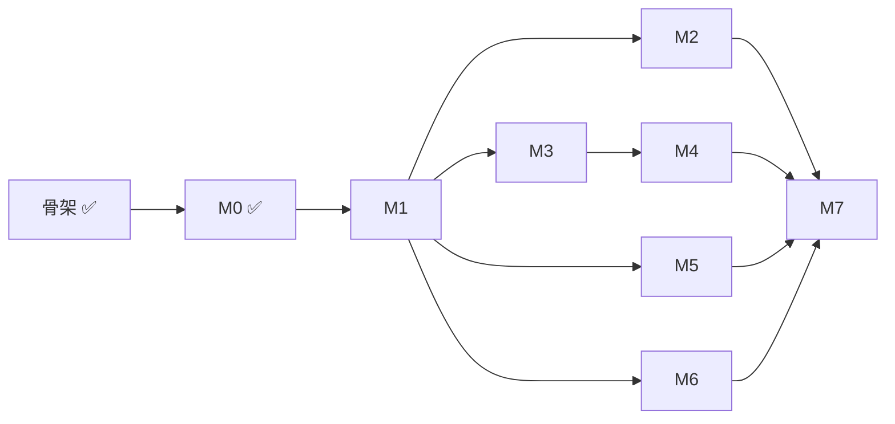

# Roadmap

按里程碑推进 [架构设计](architecture.md) 的实现。每个里程碑都以一个可演示的验收标准收尾；完成后在总览里更新状态。

## 总览

| 阶段 | 内容 | 验收标准 | 状态 |
| --- | --- | --- | --- |
| [骨架](#骨架) | 仓库结构、4 个镜像、Helm chart、Makefile、CI；gateway 签名校验；状态机与表结构 | `make lint`、`make test` 通过；Kind 上 4 个 Pod 就绪；签名正确的 webhook 返回 202，错误返回 401 | ✅ 完成 |
| [M0](#m0-runner-本地模式) | runner 本地模式：pi SDK + 重写的提示词 + `submit_review` | 对 3 个历史 PR 输出合法的 schema v3 JSON，质量不低于 v1 | ✅ 完成 |
| [M1](#m1-最小闭环) | 最小闭环：gateway 写库 + controller 建 Job + fetch 拉代码，Kind 上跑通 | 开 PR 后自动出现 Check Run 和评审评论；结论为 approve 时 AI 投出的 APPROVE 计入必需审批数 | ✅ 完成 |
| [M2](#m2-安全边界) | 安全边界：LiteLLM 虚拟 key、NetworkPolicy | runner 容器里 `env` 看不到任何真实密钥；`curl` 外网失败 | ✅ 完成 |
| [M3](#m3-可靠性) | 可靠性：幂等、session 快照恢复、superseded | 评审中途 `kubectl delete pod`，run 自动恢复且 PR 上没有重复评论 | ✅ 完成 |
| [M4](#m4-仓库配置与可选合并模式) | 仓库配置与可选合并模式（默认 vote 只投票） | 默认只投票不合并；auto 模式下 approve 后自动合并；manual 模式下等待期间无 runner Pod，`/merge` 后合并 | ✅ 完成 |
| [M5](#m5-预览环境验证) | 预览环境验证 | 故意提交一个探针配置错误的 PR，agent 通过 kubectl 发现并给出 request_changes | ✅ 完成 |
| [M6](#m6-成本看板与测算报告) | 成本看板与测算报告 | Grafana 看板 + 成本测算结果 | ✅ 完成 |
| [M7](#m7-参赛交付) | 参赛交付：演示视频、文档定稿 | 评委按 README 能在本机复现，视频覆盖完整闭环 | 未开始 |

## 依赖关系

M1 之后，M2、M3、M5、M6 可以并行。M5 依赖 demo 仓库自己的 CI 推送镜像，这部分准备工作可以更早开始。

## 骨架

已完成：

- Go module：gateway（webhook 签名校验、`pull_request` 触发解析）、controller 与 fetch 的入口、run 状态与合法转换、PostgreSQL 表结构。
- runner：pi SDK `1.3.0` 精确锁定，集群模式与本地模式入口，PR URL 解析。
- 镜像：Go 三个组件共用一个多阶段 Dockerfile（distroless nonroot），runner 基于 Node 24 slim。
- Helm chart：gateway、controller、controller 的最小 Role、webhook secret、开发用 PostgreSQL。
- `make test`、`make lint`、`make images`、`make kind-up`、`make deploy`；GitHub Actions CI。

## M0 runner 本地模式

目标：不依赖集群，`runner --pr <url>` 就能产出一份质量不低于 v1 的评审。

- [x] `runner/src/schema.ts`：用 TypeBox 定义评审结论。设计调整为 schema v3：模型直接给出 `verdict` 并写评审正文，结构只保留 `comments` 的 `path`、`line`、`severity`、`confidence`（见架构 §4.4）。
- [x] `runner/src/prompts.ts`：按 v1 的防幻觉规则重写系统提示词和用户提示词，新增判定规则和不可信输入说明。
- [x] 本地模式拉取 PR 元信息和 diff，部分克隆到临时目录。
- [x] 接入模型：DeepSeek 是 pi 内置 provider，`LLM_BASE_URL` 覆盖地址；非内置 provider 按 OpenAI 兼容接口注册（架构 §4.5）。
- [x] `submit_review` 工具：校验评论锚点落在 diff 内；模型未调用时最多追加 2 次提示。
- [x] 输出 `--format markdown|json`；结束时打印 token 和金额。
- [x] Go 侧定义同一份 schema（`go/internal/review`），`contract/` 下的生成 schema 与样例由 Go / TS 两侧测试共同校验。
- [x] 核对 pi `usage` 是否包含 cache 相关字段：包含 `cacheRead`、`cacheWrite`，DeepSeek 会填充 `cacheRead`。
- [x] 评审阶段用只读 `git` 工具代替 `bash`；不加载被评审仓库里的扩展和 `AGENTS.md`。

验收：对 3 个历史 PR 输出通过 schema 校验的 JSON，人工对比结论质量不低于 v1。

验收记录（2026-10-23，`deepseek/deepseek-flash`，thinking high；v1 使用同一模型，经 DeepSeek 的 Anthropic 兼容接口）：

| PR | 本项目结论 | 耗时 / 花费 | v1（同模型） | 对比 |
| --- | --- | --- | --- | --- |
| [ai-pr-review#15](https://github.com/RooobinYe/ai-pr-review/pull/15)：带安全问题的 webhook | request_changes，10 条评论（3 critical） | 70s / $0.020 | 9 条 must_fix，68s | 两边都找到硬编码密钥、两处 shell 注入、`rm -rf` 空路径、world-writable 权限、CI 中 PR 代码可读密钥 |
| [ai-pr-review#14](https://github.com/RooobinYe/ai-pr-review/pull/14)：JSON 输出与 `--fail-on` | request_changes，10 条评论（2 high） | 79s / $0.025 | 8 条 must_fix，205s | 共同发现 `--fail-on` 在写 `--output` 前退出（已对照源码确认）、拼错阈值时门禁失效、`pr_info` 字段为大驼峰、前置失败没有 JSON 输出；双方各有 3 到 4 条对方没有的有效发现 |
| [ai-pr-review#12](https://github.com/RooobinYe/ai-pr-review/pull/12)：Windows 控制台 API 修复 | approve，4 条 medium/low 评论 | 71s / $0.021 | 无 must_fix，136s | 结论一致；两边都指出 CI 里重复维护的 Go 版本 |

三个 PR 的结论与 v1 一致（v1 有 must_fix 即视为 request_changes），关键问题覆盖相当，单次耗时更短。所有输出通过 schema 校验，`submit_review` 都是一次调用成功，没有触发提醒。

## M1 最小闭环

目标：真实 PR 触发，结果出现在 GitHub 上。

- [x] 注册 demo 用的 GitHub App；本地 Kind 通过 webhook 转发工具（如 smee 或 cloudflared）接收事件。
- [x] GitHub App 认证：App JWT 换取 installation token。
- [x] controller 启动时执行 `store.Migrations`。
- [x] draft PR 不触发评审；转为正式 PR 的 `ready_for_review` 事件触发评审，覆盖解析与 gateway 回归测试。
- [x] gateway 写入 `review_run`（按 delivery ID 去重，`(repo, pr, head_sha)` 唯一）。
- [x] controller 用 `SELECT ... FOR UPDATE SKIP LOCKED` 领取 run，创建 Job（fetch init 容器 + runner）。
- [x] fetch：浅克隆 head、拉取 base、写出 `/workspace/pr.json`。
- [x] runner 集群模式：读取 `/workspace`，结果回调 `POST /runs/{id}/result`。
- [x] controller 创建 Check Run，发布 PR Review 投票（默认 `vote` 模式，见架构 §6.3）：正文加逐行评论，结论为 approve 时事件为 APPROVE，否则为 COMMENT，`commit_id` 取结果里的 `head_sha`；每个写操作记录到 `github_action`。
- [x] 同一 PR 的新 `head_sha` 到达时，dismiss bot 在该 PR 上仍然有效的 APPROVE；`github_action` 增加对应类型。
- [x] 实测 bot 的 APPROVE 是否计入"需要 N 个 approval"，以及 App 能否 dismiss 自己的 review；结果写回架构 §10。

验收：在 demo 仓库开 PR，几分钟内出现 "AI Review" Check Run 和评审评论；在要求 2 个审批的分支上，AI approve 加一个人的 approve 即可合并，有问题的 PR 只收到 COMMENT、不被阻塞。

验收记录（2026-10-23，本仓库 [PR #2](https://github.com/RooobinYe/ai-pr-review-cloud/pull/2)，`deepseek/deepseek-flash`，thinking high）：

| 触发 | 结果 | 耗时 / 花费 |
| --- | --- | --- |
| reopen，head `6b4558b` | COMMENT + 6 条逐行评论（1 high：`reviewed` 状态遇确定性错误会无限重试），Check Run neutral | 约 3 分钟（评审 187s） / $0.075 |
| push `3faaca9`（修复上一轮） | APPROVE + 3 条评论，Check Run success | 约 4 分钟 |
| push `fa417f4` | 先 dismiss `3faaca9` 上的 APPROVE（状态变为 DISMISSED），再 APPROVE + 6 条评论 | 约 4 分钟 |

AI 的发现中有一个安全问题（回调未鉴权，可伪造结论让 bot 投出 APPROVE），因此把 M2 的 `RUN_TOKEN` 提前到 M1；Job 创建前的 Kubernetes 错误没有时限，留到 M3 的超时与重试上限一并处理。runner 容器的环境变量里没有 GitHub token。

审批计数：仓库改为公开后，在 `main` 上开启"要求 1 个审批"。App 只有 Contents: read 时，bot 的 APPROVE 不计入（`REVIEW_REQUIRED`）；把 App 权限改为 Contents: write 并在安装上接受后，同一张票立即计入（`APPROVED`，可合并）。"AI 加一个人"的 2 票场景需要第二个人类账号，留到 M7 演示。

评论数量：前几轮每次 3 到 6 条逐行评论，偏多。提示词改为只对合并前值得处理的问题留逐行评论（通常 0 到 5 条），低级别建议并入正文的 "Minor"。

## M2 安全边界

目标：模型和 runner 拿不到任何真实凭据，也连不上外网。

- [x] chart 加入 LiteLLM proxy（`v1.104.2`），真实模型 key 只放在 proxy 里。
- [x] controller 为每次尝试签发虚拟 key，设置预算和有效期；重试时扣除已上报花费，结束、超时或 superseded 时吊销。
- [x] 独立的 `RUN_TOKEN` 用于回调鉴权，代理凭据只注入 fetch。
- [x] NetworkPolicy 只允许 DNS、LiteLLM、controller；fetch 经 controller 的 CONNECT 代理访问 GitHub（架构 §4.1）。
- [x] 超预算时以 `failed(budget_exceeded)` 结束，并写入 Check Run。

验收：runner 无真实密钥，外网访问被阻断；模型调用、预算限制与 key 吊销正常。

验收记录（2026-10-23 至 24，Kind，`deepseek/deepseek-flash`，thinking high）：

| 检查 | 结果 |
| --- | --- |
| 凭据与网络 | runner 只有虚拟 key 和回调 token；稳态下四个外网目标均超时，controller、LiteLLM 可达；代理拒绝无效凭据 |
| 预算与吊销 | 零预算被 LiteLLM 拒绝，Check Run 显示 `budget_exceeded`；run 结束后无有效 key 遗留 |
| [PR #5](https://github.com/RooobinYe/ai-pr-review-cloud/pull/5) 完整评审 | APPROVE、Check Run success；评审 258s / $0.088，LiteLLM 无重启 |

整合复测（2026-10-24，main `209ff8d`）：fetch 代理、LiteLLM 调用和重试后的 key 清理通过；剩余预算扣减由回归测试覆盖，未重复实测超预算拒绝。崩溃前未上报花费的限制见架构 §7.3。

## M3 可靠性

目标：组件崩溃后评审能继续，不产生重复的 GitHub 副作用。

- [x] runner 每轮独立上传用量和 session 快照；新 Pod 从快照续跑，已有提交结果时直接上报。
- [x] Pod 失败后重试，设置总尝试上限与超时；确定性失败不重试，失败原因写入 Check Run。
- [x] controller 重启后从数据库恢复；写 GitHub 前查找既有 Check Run、Review，避免重复发布。
- [x] 新提交使旧 run 进入 `superseded`，清理 Job 和凭据，取消 Check；新评审携带旧评论上下文。
- [x] gateway 检查迁移就绪，controller 定期重投失败 delivery；覆盖新库及 M3/M6 单独部署后的升级。
- [x] 故障回归测试覆盖恢复、幂等、超时、用量和预算；合并重复场景，保留关键断言。

验收：评审中途删除 Pod，run 自动恢复完成，PR 上没有重复评论。

验收记录（Kind，`deepseek/deepseek-flash`，thinking high）：

| 场景 | 结果 | 花费 |
| --- | --- | --- |
| [PR #3](https://github.com/RooobinYe/ai-pr-review-cloud/pull/3)，第 5 轮删 Pod | 第 2 次尝试完成，只有一个 Check Run 和一份 COMMENT Review | $0.0621 |
| 2026-10-24，main `209ff8d` 整合复测，第 1 轮删 Pod | 从快照恢复，第 2 次尝试 APPROVE；只有一个 Check Run 和一份 Review | $0.00445 |

整合复测用签名 webhook 重放触发，重复 delivery 只创建一个 run；完成后重启 controller，状态与 GitHub 结果保持不变。本次未覆盖 GitHub -> smee 实时转发。

## M4 仓库配置与可选合并模式

目标：默认的 `vote` 模式只投票、不合并；仓库可以选择让 AI 结论驱动合并，等待人工时不占算力。

- [x] 解析仓库根目录的 `.ai-pr-review.yaml`（`approvalMode`、`failOn`、`budgetUSD`、`language`），缺省时 `approvalMode` 为 `vote`。
- [x] `failOn` 校验：存在 `severity` 达到阈值的评论时，把 approve 改写为 request_changes，即只发 COMMENT、不投 APPROVE。
- [x] `decideMerge` 与 auto 模式的合并执行。
- [x] manual 模式：进入 `awaiting_approval`，接收 `/merge` 评论和人工 approve（`issue_comment`、`pull_request_review` 事件）。

验收：没有配置文件时只投票不合并；auto 模式下 approve 后自动合并；manual 模式下等待期间没有 runner Pod，评论 `/merge` 后合并。

验收记录（2026-10-24，本仓库独立测试分支，Kind，`deepseek/deepseek-flash`，thinking high；每个 run 预算 $0.10）：

| PR / 模式 | 触发与结果 | 耗时 / 花费 |
| --- | --- | --- |
| [#11](https://github.com/RooobinYe/ai-pr-review-cloud/pull/11)，默认 `vote` | base 无配置文件；真实 webhook 触发，APPROVE、Check Run success，run 到 `done`，PR 保持未合并；验收后关闭 | 33s（评审 29s） / $0.0044 |
| [#12](https://github.com/RooobinYe/ai-pr-review-cloud/pull/12)，`auto` | 从 base SHA 读取配置，APPROVE 后由 App squash 合并，run 到 `done` | 52s（评审 17s） / $0.0022 |
| [#13](https://github.com/RooobinYe/ai-pr-review-cloud/pull/13)，`manual` | APPROVE 后进入 `awaiting_approval`，Job、Pod 与本次凭据 Secret 已删除；重启 controller 后仍等待且无 runner Pod；有写权限的用户评论 [`/merge`](https://github.com/RooobinYe/ai-pr-review-cloud/pull/13#issuecomment-6370973909) 后由 App squash 合并 | 109s（评审 23s，含排队、重启和等待确认） / $0.0032 |

三次均使用真实 GitHub App、数据库、runner 和模型，APPROVE 均无逐行评论；auto/manual 的合并者为 `ai-pr-review-cloud-robin[bot]`。总耗时从收到 webhook 到 run 终态计算，评审耗时从领取到结果回调计算，费用取 runner 上报用量。验收使用独立 namespace、数据库和测试目标分支，结束后已清理；未合并到 `main`。人工 review approve 路径由自动化测试覆盖，本次真实人工确认验证的是 `/merge`。

`make test`（真实 PostgreSQL）和 `make lint` 通过。

## M5 预览环境验证

目标：把运行时证据纳入评审结论。

配置与权限范围见 [预览验证](preview.md)。实现 PR 为 [#9](https://github.com/RooobinYe/ai-pr-review-cloud/pull/9)，故障验收使用本仓库的独立示例应用。

- [x] demo 仓库的 CI 为每个 PR 推送 `:<head_sha>` 镜像。
- [x] controller 通过显式开关启用预览 ClusterRole（namespace 及必要的预览资源权限，见架构 §6.2）；为 PR 创建 `pr-<owner>-<repo>-<n>` namespace 并配 ResourceQuota。
- [x] 按 `.ai-pr-review.yaml` 的 `preview` 配置用 Helm 部署，等待 Ready 或超时。
- [x] runner 镜像加入 kubectl；预览阶段使用只能读该 namespace 的 ServiceAccount。
- [x] runner 收到 follow-up 提示后用 kubectl 检查 Pod、事件、日志。
- [x] PR 关闭时删除 namespace；定时清理超过 24 小时的孤儿 namespace。

验收：提交一个探针配置错误的 PR，agent 通过 kubectl 发现问题并给出 request_changes。

验收记录（2026-10-24，Kind，`deepseek/deepseek-flash`，thinking high）：

| PR / 场景 | 结果 | 耗时 / 花费 |
| --- | --- | --- |
| [#10](https://github.com/RooobinYe/ai-pr-review-cloud/pull/10)，head `f296c6f`，错误探针 | agent 通过 kubectl 读取 Pod、Deployment、事件和日志，确认 `/readyz` 返回 HTTP 404；request_changes，GitHub COMMENT | 209s / $0.0155 |
| [#9](https://github.com/RooobinYe/ai-pr-review-cloud/pull/9)，head `dd2ef5a`，正常对照 | Pod `1/1 Ready`，agent 检查运行时证据后 APPROVE | 362s / $0.1512（含整个实现的代码评审） |

故障 PR 已关闭且未合并，controller 自动删除了测试 namespace。只读账号不能读取 Secret、访问其他 namespace 或创建 Deployment；预览应用不挂载凭据。本次使用签名 webhook 重放，未覆盖 GitHub → smee 实时转发。

## M6 成本看板与测算报告

目标：回答赛题考核点 5（成本与性能）。

- [x] runner 每轮上报 token、缓存用量和金额；controller 从数据库生成 run 数、队列深度、各阶段耗时及成本指标（架构 §7.1）。
- [x] chart 部署 Prometheus、Grafana，提供吞吐、耗时和成本看板。
- [x] 花费达到预算 80% 时提示模型尽快提交结论（架构 §7.3）。
- [x] 测算 20 个 PR：基线各 3 次，软预算和低思考强度各 1 次，结果见 [cost-report.md](cost-report.md)。
- [x] Kind 真实评审验证看板；重试用量累计，controller 重启后指标不丢失。

验收：Grafana 展示吞吐、各阶段耗时和每 PR 成本，成本测算报告入库。

验收记录（2026-10-23 至 24，`deepseek/deepseek-flash`）：

| 检查 | 结果 |
| --- | --- |
| 基线测算（thinking high） | 单次成本 P50 $0.029、P95 $0.068，端到端 P50 106s；每月 100 个 PR、各评审 3 次约 $9 |
| $0.02 软预算 | 平均成本降低 26%、P95 降低 46%，结论与基线 20/20 一致 |
| main `209ff8d` 整合复测 | 数据库、controller、Prometheus、Grafana 数据一致；成本增加 $0.0044472、重试增加 1，controller 重启后保持不变 |

软预算不能限制单轮花费；金额按 pi 模型目录单价计算，尚未与账单核对。集群样本仍少，更大样本留到 M7。

## M7 参赛交付

目标：满足赛题考核点 4（工程完成度与 Demo 表现）。

- [ ] README 的快速开始从零验证一遍（全新机器或全新 Kind 集群）。
- [ ] 架构设计定稿，补充关键技术选型理由。
- [ ] 录制演示视频：开 PR -> 评审 -> 预览验证 -> AI 投票并与人工审批一起满足合并要求（再演示一次 auto 模式自动合并）；穿插一次 Pod 崩溃恢复和成本看板。
- [ ] 发布镜像与 chart 的版本 tag。

验收：评委按 README 能在本机复现；视频覆盖"发现 -> 分析 -> 定位 -> 修复建议 -> 验证"的完整闭环。
